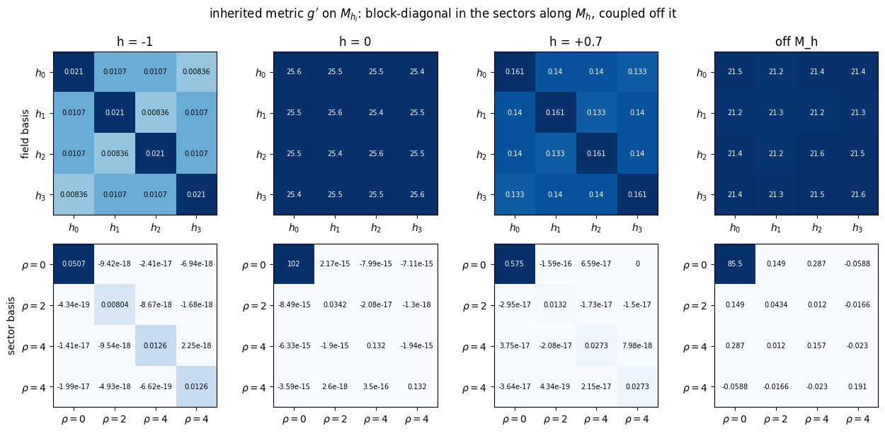
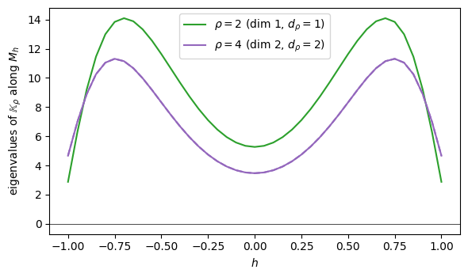
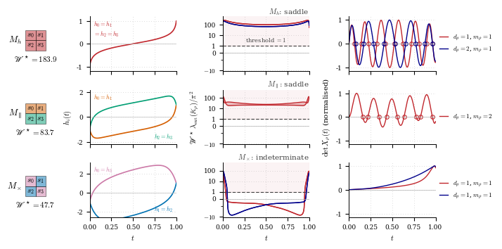

# ExtrinsicThermodynamicGeometry

Code supporting *Extrinsic thermodynamic geometry and the cost of constraint* (Sawchuk & Sivak). Notation follows the paper: states $\mu \in \Omega$, equilibrium distribution $\pi$ on the open simplex $\Delta^n$, conductance Laplacian $L$, friction metric $g = L^+$, excess work $\mathscr{W}$, symmetry sectors $\mathcal{U}_\rho$, sector curvatures $\mathbb{K}_\rho$.

## Pipeline

Given a Markov model and a pair of protocol endpoints, the code carries out the steps of the paper in order:

1. **Symmetries.** Build the edge-colored Markov graph (colors = rate laws) and compute its automorphism group $\mathrm{Aut}(G)$; restrict to the subgroup $H$ fixing the endpoints. [`symmetry.py`]
2. **Control sets.** Represent a control set $M'$ as a chart $\pi(u) = \mathrm{softmax}(\theta_0 + Bu)$, find its stabilizer $\mathrm{Aut}(G, M')$ and the induced action $S_\sigma$ of $H$ on the control coordinates, and certify totally geodesic sub-control-sets $M_H \cap M'$. [`models.py`]
3. **Sectors.** Decompose the control space into isotypic sectors under $H$ by character projectors: the invariant sector $\mathcal{U}_0$ (tangent to the symmetric control set) and the accessible symmetry-breaking sectors $\mathcal{U}_\rho$. [`symmetry.Sectors`]
4. **Curvature.** Compute the inherited metric, Christoffel symbols, and Riemann tensor of $M'$ by automatic differentiation; restrict the tidal form $R(\cdot, \dot\pi, \dot\pi, \cdot)/\|\dot\pi\|^2$ to a $g$-orthonormal frame of each sector to obtain $\mathbb{K}_\rho$. [`geometry.py`]
5. **Comparison theorem and conjugate points.** Along an optimal symmetric protocol, parallel-transport the sector frames, evaluate $\mathbb{K}_\rho(t)$, and integrate the sector Jacobi equations $\ddot{X}_\rho + \mathscr{W}^\star \mathbb{K}_\rho(t) X_\rho = 0$ to locate conjugate points, the zeros of $\det X_\rho(t)$. [`geometry.py`]

## Files

`symmetry.py` — edge-colored graphs (`ColouredGraph`), automorphism groups and endpoint stabilizers via Sage/GAP, orbits and the lumping map, isotypic decompositions (`Sectors`), and the induced representation of a group on a control space (`induced_representation`).

`models.py` — rate laws (Glauber, power-law, Arrhenius-type constant, …), the model class (`Model`: conductances, Laplacian $L$, metric $L^+$, generator $\mathbb{W}$), control sets as charts on the simplex (`ControlSet`: symmetry group, sectors, fixed subsets), the totally-geodesic certificate, and spin-system builders.

`geometry.py` — Levi-Civita geometry of the simplex (`SimplexGeometry`) and of control sets with the inherited metric (`ControlGeometry`); $g$-orthonormal sector frames and the sector curvature blocks (`K_blocks`); parallel transport; the second fundamental form of a submanifold; and the sector Jacobi integrator (`sector_jacobi`).

## Dependencies

Python ≥ 3.11.

    pip install numpy scipy networkx matplotlib jax

Group theory (automorphism groups, stabilizers, orbits, character tables) is delegated to GAP through the SageMath interface, installed from the modular [passagemath](https://passagemath.org) distribution; no full Sage install is needed:

    pip install passagemath-gap passagemath-graphs passagemath-modules passagemath-flint passagemath-pari

Binary wheels are available for Linux and macOS; Windows requires WSL.

The example below reads the optimal protocols of the four-spin control-set survey from `allProtocols.pkl`, available at [Zenodo 10.5281/zenodo.15678284](https://doi.org/10.5281/zenodo.15678284).

## Example: field control of four spins

The remainder of this notebook reproduces the four-spin analysis of the paper (Sec. IV.E and the four-spin appendix): the $D_4$ symmetry of the magnetization-reversal task, the nested field-control sets $M_h \subset M_\parallel, M_\times \subset M_{h_i}$, their sector decompositions, sector curvatures along $M_h$, and the comparison theorem and conjugate points along each optimal protocol.


```python
from symmetry import *
from models import *
from geometry import *
import numpy as np
import matplotlib.pyplot as plt
```

### Model and dynamical symmetries

`spin_system(n, law)` builds the $2^n$-state single-spin-flip model: states are bit strings, edges connect states differing by one flip, and each edge carries the dynamical law of the spin it flips. With one Glauber law for every spin, $c_{\mu\nu} = \pi_\mu\pi_\nu/(\pi_\mu + \pi_\nu)$ on every edge and the coloring is trivial. (Passing a list of  $n$ laws, one per spin, colors the edges by spin and shrinks the automorphism group accordingly.)

`M.G` is the edge-colored graph, here the tesseract (trivially colored), and `M.G.aut` its color-preserving automorphism group, computed by Sage/GAP and returned as a permutation group on the state indices $0,\dots,15$. Here, $\mathrm{Aut}(G)$ is the hyperoctahedral group of order $4!\,2^4 = 384$, consisting of permutations of the four spins combined with reversals of any subset of them.


```python
n_spins = 4

M = spin_system(n_spins, glauber(1))
plot_graph(M.G)

AutG = M.G.aut
print("|Aut(G)|:", AutG.order())
```

    |Aut(G)|: 384


    

    


### Control sets

A control set is a chart $\pi(u) = \mathrm{softmax}(\theta_0 + Bu)$: column $j$ of $B$ is the state-energy perturbation conjugate to the control coordinate $u^j$, and $\theta_0$ is a fixed background. `field_basis` and `coupling_basis` return the spin monomials $\sigma_i$ and $\sigma_i\sigma_j$ as columns, so a control set is specified by choosing which linear combinations of monomials the controller can vary and which are frozen into $\theta_0$.

The task of the paper is magnetization reversal on a $2\times2$ grid (sites $0\,1$ / $2\,3$ in reading order) with the nearest-neighbour couplings frozen at $J_{\rm NN} = 1$. We define the nested field-control sets $M_h \subset M_\parallel, M_\times \subset M_{h_i}$, representing varying spatial resolution of the field control (see the paper for definitions). We define also the full-control set $\Delta^{15}$ in Ising coordinates (all $2^4 - 1$ monomials).

`is_totally_geodesic(M, M', A)` checks whether $M \subseteq M'$ is totally geodesic by symmetry: it finds the largest subgroup $K \subseteq \mathrm{Aut}(G, M')$ fixing $M$ pointwise and checks whether $M$ is the entire fixed-point set of $K$ in $M'$.


```python
# 2x2 grid 0 1 / 2 3 in reading order; ferromagnetic nearest-neighbour couplings frozen at J_NN = 1
Bh, h_labels = field_basis(n_spins)
BJ, _ = coupling_basis(n_spins, [(0,1), (0,2), (1,3), (2,3)]);  J_NN = 1;  theta0 = BJ @ (J_NN * np.ones(4))

# nested field-control sets as explicit charts
Mh   = ControlSet(Bh @ np.array([[1, 1, 1, 1]]).T,                 theta0=theta0, name="M_h")     # one global field
Mpar = ControlSet(Bh @ np.array([[1, 1, 0, 0], [0, 0, 1, 1]]).T,   theta0=theta0, name="M_||")    # rows share a field
Mx   = ControlSet(Bh @ np.array([[1, 0, 0, 1], [0, 1, 1, 0]]).T,   theta0=theta0, name="M_x")     # diagonals share a field
Mhi  = ControlSet(Bh,                                              theta0=theta0, name="M_hi")    # four independent fields
Full, _ = spin_full_control(n_spins, name='full control')                                         # Delta^15 in Ising coordinates

# totally geodesic certificates by symmetry
for Mk in (Mh, Mpar, Mx, Mhi):
    for amb in (Mhi, Full):
        if Mk.name != amb.name:
            tg, K = is_totally_geodesic(Mk, amb, AutG)
            print(f"{Mk.name:4s} totally geodesic in {amb.name:13s}: {tg!s:5s}")
            print(f"{'':>8}K = {K.structure_description()}")
```

    M_h  totally geodesic in M_hi         : True 
            K = D4
    M_h  totally geodesic in full control : False
            K = D4
    M_|| totally geodesic in M_hi         : True 
            K = C2
    M_|| totally geodesic in full control : False
            K = C2
    M_x  totally geodesic in M_hi         : True 
            K = C2 x C2
    M_x  totally geodesic in full control : False
            K = C2 x C2
    M_hi totally geodesic in full control : False
            K = 1


### Endpoints, stabilizer, and the lumped chain

The endpoints are $\pi_0 = \pi(h = -1)$ and $\pi_1 = \pi(h = +1)$ in $M_h$. `stabilizer(A, pi0, pi1)` returns the subgroup $H \subseteq A$ fixing both distributions. Here $H \cong D_4$, the $8$ symmetries of the square.

`fixed_manifold(H)` is the fixed-point set $M_H$ as a control set, with one coordinate per orbit of $H$ (minus normalization).


```python
pi0, pi1 = Mh.pi(-1), Mh.pi(1)

H_full = stabilizer(AutG, pi0, pi1)
MH = fixed_manifold(H_full)
print("stabilizer in Aut(G):", H_full.structure_description(), " orbits:", len(orbits(H_full)), " dim M_H =", MH.dim)
print("M_H totally geodesic in Delta^15 :", is_totally_geodesic(MH, Full, AutG)[0])
print("M_h totally geodesic in M_H      :", is_totally_geodesic(Mh, MH, AutG)[0])
```

    stabilizer in Aut(G): D4  orbits: 6  dim M_H = 5
    M_H totally geodesic in Delta^15 : True
    M_h totally geodesic in M_H      : False


### Symmetries of a control set and its sectors

`Mhi.symmetry_group(AutG)` returns the stabilizer $\mathrm{Aut}(G, M_{h_i})$, the automorphisms mapping $M_{h_i}$ onto itself, together with their induced action on the control coordinates, the $m \times m$ matrices $S_\sigma$ defined by $P_\sigma B = B S_\sigma$. For field control this is the permutation of the four fields induced by the spin relabeling. `stabilizer(HB, pi0, pi1)` then restricts to the endpoint stabilizer $H \subseteq \mathrm{Aut}(G, M_{h_i})$; here it is again $D_4$.

`Mhi.fixed(H)` returns the symmetric sub-control-set $M_H \cap M_{h_i}$ and the matrix $A$ lifting its coordinates to $M_{h_i}$; here it recovers $M_h$, the direction $(1,1,1,1)$ in field space.

`Mhi.sectors(H)` is the isotypic decomposition of the control space $\mathbb{R}^4$ under the representation $\sigma \mapsto S_\sigma$ of $H$, built from the character table of $H$ by the projectors $\Pi_\rho = (d_\rho/|H|)\sum_\sigma \overline{\chi_\rho(\sigma)}\, S_\sigma$. One sector per irrep $\rho$ of $H$, of dimension $d_\rho m_\rho$ (irrep dimension times multiplicity). The invariant sector `rho0` is $\mathcal{U}_0 = T M_h$. The other sectors with nonzero dimension are the accessible symmetry-breaking directions, and a sector of dimension zero is an irrep of $H$ that field control cannot excite. The sector indices $\rho$ are rows of GAP's character table for $H$, so they are labels, not Mulliken symbols, and must be interpreted separately.

The same decomposition applies to $M_\parallel$ and $M_\times$, with $H$ replaced by the subgroup $K \subseteq \mathrm{Aut}(G, M_{h_i})$ that fixes each set pointwise ($C_2$ and $C_2 \times C_2$ respectively, as found above).


```python
S, HB = Mhi.symmetry_group(AutG)
H = stabilizer(HB, pi0, pi1)
print("H = stabilizer in Aut(G, M_hi):", H.structure_description())

Mfix, A = Mhi.fixed(H)
print("fixed set of H in M_hi: dim", Mfix.dim, " direction", np.round(A.T / np.abs(A).max(), 2), " (= M_h)")

def print_sectors(Sc, tangent_to):
    print(f"{'rho':>3} {'dim':>4} {'d':>3} {'m':>3}   kind")
    for r in range(len(Sc.Pi)):
        kind = f"invariant (tangent to {tangent_to})" if r == Sc.rho0 else ("symmetry-breaking" if Sc.dim[r] else "inaccessible")
        print(f"{r:>3} {Sc.dim[r]:>4} {Sc.d[r]:>3} {Sc.m[r]:>3}   {kind}")
        for col in Sc.U[r].T:
            print(f"{'':>18}{np.round(col / np.abs(col).max(), 2)}")

# sectors of each symmetric control set in M_hi, under the subgroup K fixing it pointwise
sectors = {}
for Mk in (Mh, Mpar, Mx):
    _, K = is_totally_geodesic(Mk, Mhi, AutG)
    sectors[Mk.name] = Mhi.sectors(K)
    print(f"\n{Mk.name}:  K = {K.structure_description()}")
    print_sectors(sectors[Mk.name], Mk.name)

Sc = sectors["M_h"]                                     # used below
```

    H = stabilizer in Aut(G, M_hi): D4
    fixed set of H in M_hi: dim 1  direction [[1. 1. 1. 1.]]  (= M_h)
    
    M_h:  K = D4
    rho  dim   d   m   kind
      0    1   1   1   invariant (tangent to M_h)
                      [1. 1. 1. 1.]
      1    0   1   0   inaccessible
      2    1   1   1   symmetry-breaking
                      [ 1. -1. -1.  1.]
      3    0   1   0   inaccessible
      4    2   2   1   symmetry-breaking
                      [-0.86 -1.    1.    0.86]
                      [-1.    0.86 -0.86  1.  ]
    
    M_||:  K = C2
    rho  dim   d   m   kind
      0    2   1   2   invariant (tangent to M_||)
                      [-1. -1. -0. -0.]
                      [-0. -0.  1.  1.]
      1    2   1   2   symmetry-breaking
                      [ 0.  0.  1. -1.]
                      [-1.  1.  0.  0.]
    
    M_x:  K = C2 x C2
    rho  dim   d   m   kind
      0    2   1   2   invariant (tangent to M_x)
                      [1. 0. 0. 1.]
                      [-0.  1.  1.  0.]
      1    0   1   0   inaccessible
      2    1   1   1   symmetry-breaking
                      [-1.  0.  0.  1.]
      3    1   1   1   symmetry-breaking
                      [-0.  1. -1.  0.]


### The inherited metric is block-diagonal in the sectors along $M_h$

`ControlGeometry(M, Mhi)` equips $M_{h_i}$ with the inherited metric $g'(u) = \mathbb{J}^{\mathsf T} L^+ \mathbb{J}$, $\mathbb{J} = \partial\pi/\partial u$. At a point of $M_h$ the metric commutes with every $S_\sigma$, $\sigma \in H$, so by Schur's lemma it is block-diagonal in the sector basis, with the block on a sector of a single irrep equal to $A_\rho \otimes I_{d_\rho}$. Off $M_h$ the symmetry is broken and the blocks couple. The figure shows $g'$ in the field basis and in the sector basis (tangent to $M_h$, then the accessible breaking sectors) at three points of $M_h$ and one generic point: along $M_h$ the sector-basis matrix is diagonal, with the two entries of the two-dimensional sector equal ($d_\rho = 2$, $m_\rho = 1$). The same block structure holds for every $H$-equivariant tensor, in particular the curvature.


```python
geo_hi = ControlGeometry(M, Mhi)

N, labels = Sc.normal_basis()
Q = np.hstack([A, N])                                   # (tangent to M_h | normal sectors)
sec = [Sc.rho0] + [int(l) for l in labels]              # sector index of each column, e.g. [0, 1, 4, 4]

points = [("h = -1", -np.ones(4)), ("h = 0", np.zeros(4)),
          ("h = +0.7", 0.7 * np.ones(4)), ("off M_h", np.array([0.3, -0.5, 0.2, 0.1]))]

fig, axes = plt.subplots(2, len(points), figsize=(3.2 * len(points), 6.2))
for j, (title, u) in enumerate(points):
    G = np.asarray(geo_hi.metric(u))
    for i, (Mat, ylab) in enumerate([(G, "field basis"), (Q.T @ G @ Q, "sector basis")]):
        ax = axes[i, j]
        rel = np.abs(Mat) / np.abs(Mat).max()
        ax.imshow(rel, cmap="Blues", vmin=0, vmax=1)
        for (r, c), v in np.ndenumerate(Mat):
            ax.text(c, r, f"{v:.3g}", ha="center", va="center", fontsize=7,
                    color="white" if rel[r, c] > 0.6 else "black")
        ticks = [f"$h_{k}$" for k in range(4)] if i == 0 else [rf"$\rho={s}$" for s in sec]
        ax.set_xticks(range(4)); ax.set_yticks(range(4))
        ax.set_xticklabels(ticks); ax.set_yticklabels(ticks)
        if i == 0: ax.set_title(title)
        if j == 0: ax.set_ylabel(ylab)
fig.suptitle("inherited metric $g'$ on $M_{h_i}$: block-diagonal in the sectors along $M_h$, coupled off it")
plt.tight_layout()
```


    

    


### Second fundamental form

`second_fundamental_form(sub, amb, embed, u)` evaluates $\mathrm{I\!I}$ of a submanifold in an ambient manifold at the submanifold coordinates $u$ given the embedding map, from the Gauss formula. $\mathrm{I\!I} \equiv 0$ if and only if the submanifold is totally geodesic. The code below confirms the results from symmetry above directly: $M_h$ is totally geodesic in $M_{h_i}$ (residual at machine precision), but not in $\Delta^{15}$, where $\mathrm{I\!I}$ is large near the transition region of the ferromagnet. With the simplex as ambient space the embedding is the chart `Mh.pi` itself.


```python
geo = SimplexGeometry(M)                 # the simplex with g = L^+, coordinates pi
g_h = ControlGeometry(M, Mh)             # M_h with its inherited metric, coordinate h

embed_in_hi = lambda h: jnp.ones(4) * jnp.atleast_1d(h)      # M_h -> M_hi: h -> (h, h, h, h)
for h in (-1.0, -0.3, 0.5):
    II_hi = second_fundamental_form(g_h, geo_hi, embed_in_hi, jnp.array([h]))
    II_D  = second_fundamental_form(g_h, geo,    Mh.pi,       jnp.array([h]))
    print(f"h = {h:+.1f}:  |II| of M_h in M_hi = {float(jnp.abs(II_hi).max()):.1e}    in Delta^15 = {float(jnp.abs(II_D).max()):.3f}")
```

    h = -1.0:  |II| of M_h in M_hi = 1.2e-14    in Delta^15 = 0.036
    h = -0.3:  |II| of M_h in M_hi = 4.7e-13    in Delta^15 = 24.485
    h = +0.5:  |II| of M_h in M_hi = 9.8e-14    in Delta^15 = 4.429


### Sector curvatures along $M_h$

`geo.tidal(x, v)` is the normalized tidal form $R(\cdot, v, v, \cdot)/\|v\|^2$ at $x$, whose diagonal entries in a $g$-orthonormal frame are the sectional curvatures of the planes spanned with $v$. `K_blocks(geo, x, v, Sc)` restricts it to a $g$-orthonormal frame of each accessible breaking sector of `Sc` and returns the blocks $\mathbb{K}_\rho$ with their eigenvalues.


```python
hs = np.linspace(-1, 1, 41)
v = np.ones(4)                                                 # tangent of M_h in field coordinates
curv = {r: [] for r in Sc.accessible}
for h in hs:
    for r, (K, w) in K_blocks(geo_hi, jnp.asarray(h * np.ones(4)), jnp.asarray(v), Sc).items():
        curv[r].append(np.asarray(w))

fig, ax = plt.subplots(figsize=(6, 3.6))
for r, W in curv.items():
    W = np.array(W)
    for i in range(W.shape[1]):
        ax.plot(hs, W[:, i], color=f"C{r}", ls="-" if i == 0 else "--",
                label=rf"$\rho={r}$ (dim {Sc.dim[r]}, $d_\rho={Sc.d[r]}$)" if i == 0 else None)
ax.axhline(0, color="k", lw=0.5)
ax.set_xlabel("$h$"); ax.set_ylabel(r"eigenvalues of $\mathbb{K}_\rho$ along $M_h$")
ax.legend()
plt.tight_layout()
```


    

    


### Comparison theorem and conjugate points along the optimal protocols

The optimal protocols are taken from the published control-set survey [*4 spin system protocols and spectra* (Zenodo)](https://doi.org/10.5281/zenodo.15678284). Each row of `allProtocols.pkl` holds the state energies $V(t)$ along one protocol and its excess work $\mathscr{W}^\star$; converting $V(t)$ to field coordinates $h_i(t)$ places every protocol in the ambient $M_{h_i}$.

For each protocol, the relevant group is the subgroup $K \subseteq \mathrm{Aut}(G, M_{h_i})$ fixing the protocol pointwise, and the sectors are those of $K$ acting on the field space, computed independently for each set. `K_along_path(geo, path, t, Sc)` evaluates $\mathbb{K}_\rho(t)$ along the protocol in a parallel-transported $g$-orthonormal frame of each accessible sector, and `reduced_curvature` rescales the eigenvalues by $\mathscr{W}^\star/\pi^2$ so that the thresholds of the comparison theorem sit at 1: a sector whose smallest reduced eigenvalue stays above 1 certifies a saddle, while all largest eigenvalues below 1 certify a strict local minimum. `sector_jacobi` then integrates the matrix Jacobi equation $\ddot{X}_\rho + \mathscr{W}^\star\mathbb{K}_\rho(t)X_\rho = 0$, $X_\rho(0) = 0$, $\dot{X}_\rho(0) = I$, and reports the zeros of $\det X_\rho$ as conjugate points (with multiplicity $d_\rho$ in a sector carrying a single $d_\rho$-dimensional irrep, where the scalar equation is integrated instead).

The figure reproduces Fig. 3 of the paper: control set and $\mathscr{W}^\star$, optimal protocol, reduced sector curvatures against the threshold, and $\det X_\rho(t)$ with its conjugate points.


```python
import pickle

df = pickle.load(open("../fourSpinData/allProtocols.pkl", "rb"));
CSETS = {r"$M_h$": [[0, 1, 2, 3]], r"$M_\parallel$": [[0, 1], [2, 3]], r"$M_\times$": [[0, 3], [1, 2]]}

prots = {}
for name, cset in CSETS.items():
    r = next(r for _, r in df.iterrows() if r["cSet"] == cset)
    V = np.asarray(r["V(t)"], float)                              # (N, 16) state energies along the protocol
    w = np.exp(-V - (-V).max(1, keepdims=True)); pis = w / w.sum(1, keepdims=True)
    path = np.array([Mhi.coordinates(p) for p in pis])            # field coordinates h_i(t)
    prots[name] = dict(t=np.linspace(0, 1, len(V)),  
                       path=path,  
                       W=float(r["Work"]))
    

# ---- computation: sectors, curvature, and Jacobi fields along each optimal protocol ----
results = {}
for name, P in prots.items():
    t, path, W = P["t"], P["path"], P["W"]
    K  = stabilizer(HB, *[Mhi.pi(u) for u in path[::5]])                 # subgroup fixing this protocol pointwise
    Sk = Mhi.sectors(K)
    Kt = K_along_path(geo_hi, path, t, Sk)                               # {rho: (N+1, dim_rho, dim_rho)}

    sect = {}
    for r in Sk.accessible:
        lam = reduced_curvature(Kt[r], W)                                # W* lambda(K_rho) / pi^2, (N+1, dim_rho)
        jac = sector_jacobi(geo_hi, Sk, path, t, W, r, n_steps=5000)     # integrate sector Jacobi equations along the path
        sect[r] = dict(dim=int(Sk.dim[r]), 
                       d=int(Sk.d[r]), 
                       m=int(Sk.m[r]), 
                       basis=np.asarray(Sk.U[r]),
                       K=Kt[r], 
                       lam_min=lam.min(1), 
                       lam_max=lam.max(1),
                       ts=jac["ts"], 
                       det_sign=jac["det_sign"], 
                       det_logabs=jac["det_logabs"],
                       conjugate=jac["conjugate"], 
                       multiplicity=jac["multiplicity"], 
                       index=jac["index"])

    saddle    = any(s["lam_min"].min() > 1 for s in sect.values())      # some sector above the upper threshold everywhere
    local_min = all(s["lam_max"].max() < 1 for s in sect.values())      # every sector below the lower threshold everywhere
    
    results[name] = dict(t=t,
                         path=path,
                         W=W,
                         group=K.structure_description(),
                         sectors=sect,
                         verdict="saddle" if saddle else ("local minimum" if local_min else "indeterminate"),
                         conjugate=any(s["index"] > 0 for s in sect.values()))   # conjugate point in (0,1) in some sector

    print(f"\n{name}:  K = {results[name]['group']},  comparison theorem: {results[name]['verdict']},  "
          f"conjugate point in (0,1): {results[name]['conjugate']}")

    print_sectors(Sk, name)
```

    /var/folders/vt/dk1_7_cj7nn5lqzp5h5_0ptr0000gn/T/ipykernel_36944/2269722071.py:3: DeprecationWarning: numpy.core.numeric is deprecated and has been renamed to numpy._core.numeric. The numpy._core namespace contains private NumPy internals and its use is discouraged, as NumPy internals can change without warning in any release. In practice, most real-world usage of numpy.core is to access functionality in the public NumPy API. If that is the case, use the public NumPy API. If not, you are using NumPy internals. If you would still like to access an internal attribute, use numpy._core.numeric._frombuffer.
      df = pickle.load(open("../fourSpinData/allProtocols.pkl", "rb"));


    
    $M_h$:  K = D4,  comparison theorem: saddle,  conjugate point in (0,1): True
    rho  dim   d   m   kind
      0    1   1   1   invariant (tangent to $M_h$)
                      [1. 1. 1. 1.]
      1    1   1   1   symmetry-breaking
                      [ 1. -1. -1.  1.]
      2    0   1   0   inaccessible
      3    0   1   0   inaccessible
      4    2   2   1   symmetry-breaking
                      [-0.86 -1.    1.    0.86]
                      [-1.    0.86 -0.86  1.  ]
    
    $M_\parallel$:  K = C2,  comparison theorem: saddle,  conjugate point in (0,1): True
    rho  dim   d   m   kind
      0    2   1   2   invariant (tangent to $M_\parallel$)
                      [-1. -1. -0. -0.]
                      [-0. -0.  1.  1.]
      1    2   1   2   symmetry-breaking
                      [ 0.  0.  1. -1.]
                      [-1.  1.  0.  0.]
    
    $M_\times$:  K = C2 x C2,  comparison theorem: indeterminate,  conjugate point in (0,1): False
    rho  dim   d   m   kind
      0    2   1   2   invariant (tangent to $M_\times$)
                      [1. 0. 0. 1.]
                      [-0.  1.  1.  0.]
      1    1   1   1   symmetry-breaking
                      [-1.  0.  0.  1.]
      2    1   1   1   symmetry-breaking
                      [-0.  1. -1.  0.]
      3    0   1   0   inaccessible


```python
# Plotting parameters
from matplotlib.patches import Rectangle
from matplotlib.lines import Line2D

# ---- style (paper palette; cmr-style math without usetex) ----
plt.rcParams.update({"font.family": "serif", "mathtext.fontset": "cm", "axes.unicode_minus": False,
                     "font.size": 8, "axes.labelsize": 9, "axes.titlesize": 8.5, "legend.fontsize": 7,
                     "axes.linewidth": 0.7, "pdf.fonttype": 42})
PAL = dict(fireEngine="#C1272D", navyBlue="#00008B", teal="#457E88", grey="#3f3f3f")
SECTOR_COLORS = [PAL["fireEngine"], PAL["navyBlue"], PAL["teal"]]               
GROUP_COLORS  = {r"$M_h$": [PAL["fireEngine"]], r"$M_\parallel$": ["#D55E00", "#009E73"], r"$M_\times$": ["#CC79A7", "#0072B2"]}
YLIM_L        = {r"$M_h$": (-1.2, 1.2), r"$M_\parallel$": (-2.2, 2.2), r"$M_\times$": (-2.6, 3.2)}

def style_axis(ax, xlab=None):
    ax.grid(True, ls=(0, (1, 3)), lw=0.6, color="0.55", alpha=0.4, zorder=0)
    ax.set_xlim(0, 1); ax.set_xticks([0, .25, .5, .75, 1.])
    for sp in ("top", "right"): ax.spines[sp].set_visible(False)
    if xlab: ax.set_xlabel(xlab)

def group_label(grp):
    s = sorted(grp)
    return "$h_0 = h_1$\n$= h_2 = h_3$" if len(s) == 4 else "$" + " = ".join(rf"h_{i}" for i in s) + "$"

def spin_block(ax, groups, colors, name, W):
    """2x2 grid of sites 0 1 / 2 3, colored by control group"""
    pos = {0: (0, 1), 1: (1, 1), 2: (0, 0), 3: (1, 0)}
    for gi, grp in enumerate(groups):
        for s in grp:
            x, y = pos[s]
            ax.add_patch(Rectangle((x, y), 1, 1, facecolor=colors[gi], alpha=0.5, edgecolor="k", lw=0.6))
            ax.text(x + 0.5, y + 0.5, rf"$s_{s}$", ha="center", va="center", fontsize=8)
    ax.text(-0.35, 1.0, name, ha="right", va="center", fontsize=9)
    ax.text(1.0, -0.35, rf"$\mathscr{{W}}^\star = {W:.1f}$", ha="center", va="top", fontsize=8)
    ax.set_xlim(-1.4, 2.2); ax.set_ylim(-0.9, 2.2); ax.set_aspect("equal"); ax.axis("off")

plt.rcParams.update({"font.size": 7, "axes.labelsize": 7.5, "axes.titlesize": 7.5, "legend.fontsize": 6.5,
                     "xtick.labelsize": 6.5, "ytick.labelsize": 6.5})
fig, axes = plt.subplots(3, 4, figsize=(7.0, 3.4), sharex="col", layout="constrained",
                         gridspec_kw=dict(width_ratios=[0.42, 1, 1, 1]))
fig.get_layout_engine().set(w_pad=2 / 72, h_pad=2 / 72, wspace=0.04, hspace=0.06)

for i, (name, R) in enumerate(results.items()):
    t, path, W = R["t"], R["path"], R["W"]

    # column 0: control set & excess work
    spin_block(axes[i, 0], CSETS[name], GROUP_COLORS[name], name, W)

    # column 1: optimal protocols
    ax = axes[i, 1]
    for gi, grp in enumerate(CSETS[name]):
        ax.plot(t, path[:, grp[0]], color=GROUP_COLORS[name][gi], lw=1.2)
        ax.annotate(group_label(grp), xy=(0.04, 0.94) if gi == 0 else (0.96, 0.06), xycoords="axes fraction",
                    ha="left" if gi == 0 else "right", va="top" if gi == 0 else "bottom",
                    fontsize=6, color=GROUP_COLORS[name][gi])
    ax.axhline(0, color="0.75", lw=0.5); ax.set_ylim(*YLIM_L[name]); style_axis(ax)

    # column 2: reduced sector curvatures vs. the threshold
    ax = axes[i, 2]
    for k, (r, s) in enumerate(R["sectors"].items()):
        col = SECTOR_COLORS[k]
        ax.plot(t, s["lam_max"], color=col, lw=1.0); ax.plot(t, s["lam_min"], color=col, lw=1.0)
        if not np.allclose(s["lam_min"], s["lam_max"]):
            ax.fill_between(t, s["lam_min"], s["lam_max"], color=col, alpha=0.25, lw=0)
    ax.axhspan(1, 1e4, color=PAL["fireEngine"], alpha=0.05, zorder=0)
    ax.axhline(1, color="0.25", ls=(0, (4, 2)), lw=0.8)
    ax.axhline(0, color="0.7", lw=0.5)
    ax.set_yscale("symlog", linthresh=1, linscale=0.6); ax.set_ylim(-12, 600)
    ax.set_yticks([-10, 0, 1, 10, 100]); ax.set_yticklabels([r"$-10$", "0", "1", "10", "100"])
    ax.set_title(f"{name}: {R['verdict']}", loc="right", pad=2, color="0.25")
    style_axis(ax)

    # column 3: det X_rho(t) and conjugate points
    ax = axes[i, 3]
    for k, (r, s) in enumerate(R["sectors"].items()):
        col = SECTOR_COLORS[k]
        det = s["det_sign"] * np.exp(s["det_logabs"] - np.nanmax(s["det_logabs"][1:]))
        ax.plot(s["ts"], det, color=col, lw=1.0, label=rf"$d_\rho={s['d']}$, $m_\rho={s['m']}$")
        for c in s["conjugate"]: ax.plot(c, 0, "o", mfc="none", color=col, ms=4, mew=0.8)
    ax.axhline(0, color="0.7", lw=0.5); ax.set_ylim(-1.15, 1.15); ax.set_yticks([-1, 0, 1])
    ax.legend(frameon=False, loc="center left", bbox_to_anchor=(1.0, 0.5), handlelength=1.3, borderaxespad=0.2)
    style_axis(ax)

axes[0, 2].annotate(r"threshold $=1$", xy=(0.5, 2.4), fontsize=6, color="0.25", ha="center")
axes[1, 1].set_ylabel(r"$h_i(t)$")
axes[1, 2].set_ylabel(r"$\mathscr{W}^\star\,\lambda_{\rm ext}(\mathbb{K}_\rho)/\pi^2$")
axes[1, 3].set_ylabel(r"$\det X_\rho(t)$ (normalised)")
for ax in axes[-1, 1:]: ax.set_xlabel("$t$")
```


    

    


## References
- The Sage Developers, *SageMath, the Sage Mathematics Software System (Version 10.x)*, https://www.sagemath.org, DOI 10.5281/zenodo.8042260.
- The GAP Group, *GAP – Groups, Algorithms, and Programming, Version 4.14.0*, 2024, https://www.gap-system.org.
- J. Sawchuk, *4 spin system protocols and spectra*, Zenodo (2025), doi:10.5281/zenodo.15678284.
