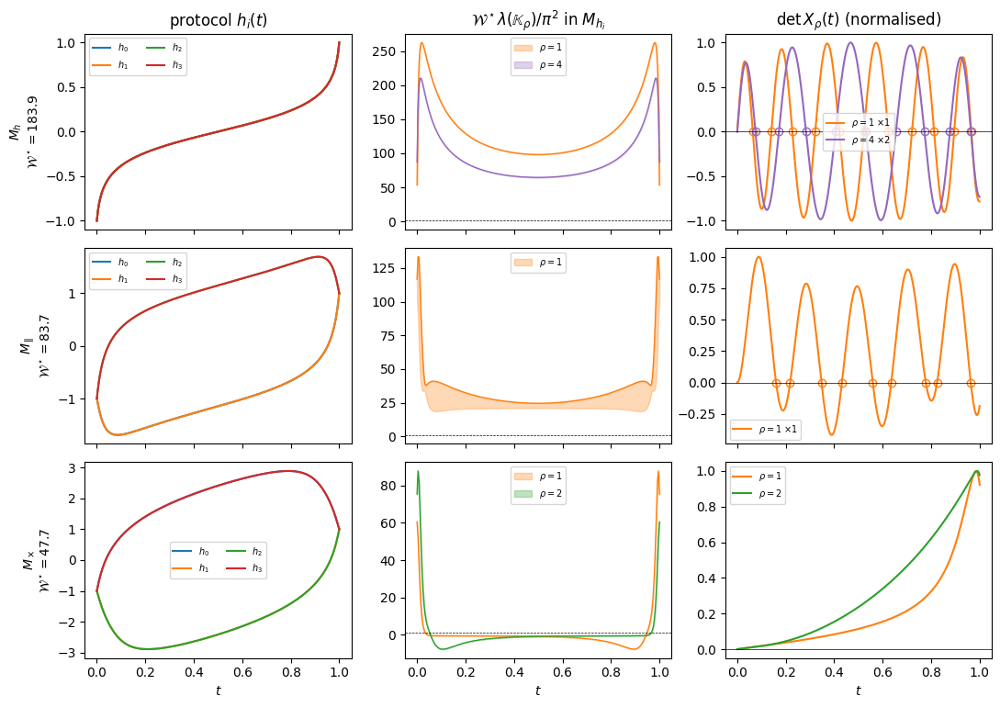

# ExtrinsicThermodynamicGeometry

Code supporting *Extrinsic thermodynamic geometry and the cost of constraint*. 

## Files

`symmetry.py` : edge-coloured Markov graphs, their automorphism groups, the isotypic decomposition of $\mathbb{R}^n$ under a subgroup, and the induced representation of a group on a control set

`models.py`   : Markov models built on graph structure - colours assigned by rate laws, rate matrix $\mathbb{W}$, Laplacian $L$, friction metric $g = L^+$, control sets as submanifolds of the simplex with inherited symmetry, and spin-system builders.

`geometry.py` : the friction geometry of the simplex ($g = L^+$) and of control sets with the inherited metric $J^\mathsf{T} L^+ J$, incl. Christoffel symbols, Riemann and tidal curvature by automatic differentiation; $g$-orthonormal sector frames and the sector curvature blocks $\mathbb{K}_\rho$; parallel transport along a protocol; the second fundamental form of a submanifold; and integration of the sector Jacobi equation $\ddot{x}_\rho + \mathscr{W}^\star \mathbb{K}_\rho(t)\, x_\rho = 0$ to locate conjugate points.

## Dependencies

Python ≥ 3.11

Numerics and plotting:

    pip install numpy scipy networkx matplotlib jax

Group theory (automorphism groups, stabilizers, orbits, character tables) carried out by GAP through the SageMath interface, installed from the modular [passagemath](https://passagemath.org) distribution; no full Sage install is needed:

    pip install passagemath-gap passagemath-graphs passagemath-modules passagemath-flint passagemath-pari

Binary wheels are available for Linux and macOS; Windows requires WSL.


## Example usage


```python
from symmetry import *
from models import *
from geometry import *
import numpy as np
import matplotlib.pyplot as plt
```

Define the 2x2 spin system, plot G, and retrieve Aut(G).


```python
n_spins = 4

M = spin_system(n_spins, glauber(1))
plot_graph(M.G);

AutG = M.G.aut
print("|Aut(G)|: ", AutG.order())
```

    |Aut(G)|:  384


    

    


Define the field-only control sets of varying resolution with $J_{\rm NN} = 1$ fixed, and define also the full-control set. Check total geodesity by symmetries.


```python
# 2x2 grid 0 1 / 2 3 in normal reading order; fixed ferromegnetic nearest-neighbour couplings at the endpoints
Bh, h_labels = field_basis(n_spins)
BJ, _ = coupling_basis(n_spins, [(0,1), (0,2), (1,3), (2,3)]);  J_NN = 1;  theta0 = BJ @ (J_NN * np.ones(4)) 

# nested field control sets, as explicit charts
Mh  = ControlSet(Bh @ np.array([[1, 1, 1, 1]]).T, theta0=theta0, name="M_h")    # one field
Mx  = ControlSet(Bh @ np.array([[1, 0, 0, 1], [0, 1, 1, 0]]).T, theta0=theta0, name="M_x")    # diagonals share a field
Mpar = ControlSet(Bh @ np.array([[1, 1, 0, 0], [0, 0, 1, 1]]).T, theta0=theta0, name="M_||")   # rows share a field
Mhi = ControlSet(Bh, theta0=theta0, name='M_hi') # Full field control
Full, _ = spin_full_control(4)


S, HB = Full.symmetry_group(M.G.aut)                   # induced representation dict and group H_B
# Check total geodesity
for Mk in (Mh, Mx, Mpar, Mhi):
    for amb in (Mhi, Full):
        if Mk.name != amb.name:
            bool, K = is_totally_geodesic(Mk, amb, HB)
            print(f"{Mk.name} in {amb.name}: {bool},  K = {K.structure_description()}")
```

    M_h in M_hi: True,  K = D4
    M_h in full control (4 spins): False,  K = D4
    M_x in M_hi: True,  K = C2 x C2
    M_x in full control (4 spins): False,  K = C2 x C2
    M_|| in M_hi: True,  K = C2
    M_|| in full control (4 spins): False,  K = C2
    M_hi in full control (4 spins): False,  K = 1


Set the endpoints $\pi_0 = \pi(h{=}{-1})$ and $\pi_1 = \pi(h{=}{+1})$ in $M_h$.

`stabilizer(AutG, pi0, pi1)` is the subgroup of $\mathrm{Aut}(G)$ fixing both endpoints, and `fixed_manifold(H)` is its fixed set $M_H$, the distributions constant on the orbits of $H$ (dimension = number of orbits − 1; the lumped chain). $M_H$ is totally geodesic in the simplex.


```python
pi0, pi1 = Mh.pi(-1), Mh.pi(1)

H_full = stabilizer(AutG, pi0, pi1)
MH = fixed_manifold(H_full)
print("stabilizer in Aut(G):", H_full.structure_description(), " orbits:", len(orbits(H_full)), " dim M_H =", MH.dim)
print("M_H totally geodesic in the simplex:", is_totally_geodesic(MH, Full, AutG)[0])
print("M_h totally geodesic in M_H:        ", is_totally_geodesic(Mh, MH, AutG)[0])
```

    stabilizer in Aut(G): D4  orbits: 6  dim M_H = 5
    M_H totally geodesic in the simplex: True
    M_h totally geodesic in M_H:         False


`Mhi.symmetry_group(AutG)` returns $\mathrm{Aut}(G, M_{h_i})$, the symmetries mapping $M_{h_i}$ to itself, with their induced action $S_\sigma$ on the field coordinates ($P_\sigma B = B S_\sigma$); `stabilizer(HB, pi0, pi1)` returns the subgroup $H \leq \mathrm{Aut}(G, M_{h_i})$ that fixes the endpoints. (Here `H` and `H_full` are the same group). `Mhi.fixed(H)` gives the fixed set of $H$ within $M_{h_i}$, or $M_H \cap M_{h_i}$, recovering $M_h$. `Mhi.sectors(H)` decomposes the field space $\mathbb{R}^4$ into isotypic sectors under $H$: the invariant sector $\mathcal{U}_0$ is the tangent space of $M_h$, the others are the symmetry-breaking directions, and an irrep of dimension 0 here is a symmetry that field control cannot break.


```python
S, HB = Mhi.symmetry_group(AutG)
H = stabilizer(HB, pi0, pi1)
print("H = stabilizer in Aut(G, M_hi):", H.structure_description())

Mfix, A = Mhi.fixed(H)
print("fixed set of H in M_hi: dim", Mfix.dim, " direction", np.round(A.T / np.abs(A).max(), 2), " (= M_h)")

Sc = Mhi.sectors(H)
for r in range(len(Sc.Pi)):
    kind = "invariant (tangent to M_h)" if r == Sc.rho0 else ("breaking" if Sc.dim[r] else "inaccessible")
    print(f"rho={r}: dim {Sc.dim[r]}  d={Sc.d[r]} m={Sc.m[r]}  {kind}")
    for col in Sc.U[r].T:
        print("        ", np.round(col / np.abs(col).max(), 2))
```

    H = stabilizer in Aut(G, M_hi): D4
    fixed set of H in M_hi: dim 1  direction [[1. 1. 1. 1.]]  (= M_h)
    rho=0: dim 1  d=1 m=1  invariant (tangent to M_h)
             [1. 1. 1. 1.]
    rho=1: dim 1  d=1 m=1  breaking
             [ 1. -1. -1.  1.]
    rho=2: dim 0  d=1 m=0  inaccessible
    rho=3: dim 0  d=1 m=0  inaccessible
    rho=4: dim 2  d=2 m=1  breaking
             [-0.86 -1.    1.    0.86]
             [-1.    0.86 -0.86  1.  ]


The inherited metric $\zeta(h_i) = J^\mathsf{T} L^+ J$ on $M_{h_i}$ is $H$-invariant, so at every point of $M_h$ it is block-diagonal in the sector basis (Schur's lemma), while off $M_h$ the symmetry is broken and the blocks couple. Blocks are labelled by sector: $\rho = 0$ is tangent to $M_h$, and only $\rho = 1, 4$ are accessible symmetry-breaking sectors here. Sector $\rho = 4$ carries a single 2-dimensional irrep ($d_\rho = 2$, $m_\rho = 1$), on which $\zeta$ must act as a multiple of the identity, hence the two equal entries.


```python
geo_hi = ControlGeometry(M, Mhi)
N, labels = Sc.normal_basis()
Q = np.hstack([A, N])                                   # (tangent to M_h | normal sectors)
sec = [Sc.rho0] + [int(l) for l in labels]              # sector index of each column, e.g. [0, 1, 4, 4]

points = [("h = -1", -np.ones(4)), ("h = 0", np.zeros(4)),
          ("h = +0.7", 0.7 * np.ones(4)), ("off M_h", np.array([0.3, -0.5, 0.2, 0.1]))]

fig, axes = plt.subplots(2, len(points), figsize=(3.2 * len(points), 6.2))
for j, (title, u) in enumerate(points):
    G = np.asarray(geo_hi.metric(u))
    for i, (Mat, ylab) in enumerate([(G, "field basis"), (Q.T @ G @ Q, "sector basis")]):
        ax = axes[i, j]
        rel = np.abs(Mat) / np.abs(Mat).max()
        ax.imshow(rel, cmap="Blues", vmin=0, vmax=1)
        for (r, c), v in np.ndenumerate(Mat):
            ax.text(c, r, f"{v:.3g}", ha="center", va="center", fontsize=7,
                    color="white" if rel[r, c] > 0.6 else "black")
        ticks = [f"$h_{k}$" for k in range(4)] if i == 0 else [rf"$\rho={s}$" for s in sec]
        ax.set_xticks(range(4)); ax.set_yticks(range(4))
        ax.set_xticklabels(ticks); ax.set_yticklabels(ticks)
        if i == 0: ax.set_title(title)
        if j == 0: ax.set_ylabel(ylab)
fig.suptitle("inherited metric $\\zeta$ on $M_{h_i}$: block-diagonal in the sectors along $M_h$, coupled off it")
plt.tight_layout()
```


    

    


`second_fundamental_form(sub, amb, embed, u)` computes $\mathrm{I\!I}$ of a submanifold in an ambient manifold at coordinates $u$, given the embedding map. A submanifold is totally geodesic in the ambient space if and only if $\mathrm{I\!I} \equiv 0$ everywhere. The cell below supports the claim that $M_h$ is totally geodesic in $M_{h_i}$, but not in $\Delta^{15}$.  


```python
geo  = SimplexGeometry(M)                # the simplex with g = L^+
g_hi = ControlGeometry(M, Mhi)           # M_hi with the inherited metric, field coordinates
g_h  = ControlGeometry(M, Mh)            # M_h, coordinate h

embed_in_hi = lambda h: jnp.ones(4) * jnp.atleast_1d(h)      # M_h -> M_hi: h -> (h, h, h, h)
for h in (-1.0, -0.3, 0.5):
    II_hi = second_fundamental_form(g_h, g_hi, embed_in_hi, jnp.array([h]))
    II_D  = second_fundamental_form(g_h, geo,  Mh.pi,       jnp.array([h]))
    print(f"h = {h:+.1f}:  |II| of M_h in M_hi = {float(jnp.abs(II_hi).max()):.1e}    in the simplex = {float(jnp.abs(II_D).max()):.3f}")
```

    h = -1.0:  |II| of M_h in M_hi = 1.2e-14    in the simplex = 0.036
    h = -0.3:  |II| of M_h in M_hi = 4.7e-13    in the simplex = 24.485
    h = +0.5:  |II| of M_h in M_hi = 9.8e-14    in the simplex = 4.429


`K_blocks(geo, x, v, S)` restricts the the tidal form $R(\cdot, v, \cdot, v)/\|v\|^2$ of the ambient geometry to a $g$-orthonormal frame of each accessible symmetry-breaking sector, and the resulting blocks are the sector curvatures $\mathbb{K}_\rho$. Along $M_h$ the tidal form is block-diagonal in the sectors, and within $\rho = 4$ the two eigenvalues coincide ($d_\rho = 2$). Positive curvatures focus geodesics and indicate symmetries that might be worth breaking. For $M_h$, both symmetries are worth breaking. 


```python
hs = np.linspace(-1, 1, 41)
v = np.ones(4)                                                 # tangent of M_h in field coordinates
curv = {r: [] for r in Sc.accessible}
for h in hs:
    for r, (K, w) in K_blocks(g_hi, jnp.asarray(h * np.ones(4)), jnp.asarray(v), Sc).items():
        curv[r].append(np.asarray(w))

fig, ax = plt.subplots(figsize=(6, 3.6))
for r, W in curv.items():
    W = np.array(W)
    for i in range(W.shape[1]):
        ax.plot(hs, W[:, i], color=f"C{r}", ls="-" if i == 0 else "--", label=rf"$\rho={r}$" if i == 0 else None)
ax.axhline(0, color="k", lw=0.5)
ax.set_xlabel("$h$"); ax.set_ylabel(r"eigenvalues of $\mathbb{K}_\rho$")
ax.legend()
plt.tight_layout()
```


    

    


Given an optimal protocol in a submanifold, `K_along_path` returns the sector curvatures $\mathbb{K}_\rho(t)$ and `sector_jacobi` integrates the independent Jacobi equations and identifies their conjugate points.

Below, the optimal protocols are taken from the published control-set survey [*4 spin system protocols and spectra* (Zenodo)](https://doi.org/10.5281/zenodo.15678284). Each row of `allProtocols.pkl` holds the state energies $V(t)$ along one protocol and its excess work $\mathcal{W}^\star$. Converting $V(t)$ to field coordinates $h_i(t)$ puts every protocol in the ambient $M_{h_i}$.


```python
import pickle
g_hi = ControlGeometry(M, Mhi)

df = pickle.load(open("../fourSpinData/allProtocols.pkl", "rb"));
CSETS = {r"$M_h$": [[0, 1, 2, 3]], r"$M_\parallel$": [[0, 1], [2, 3]], r"$M_\times$": [[0, 3], [1, 2]]}

prots = {}
for name, cset in CSETS.items():
    r = next(r for _, r in df.iterrows() if r["cSet"] == cset)
    V = np.asarray(r["V(t)"], float)                              # (N, 16) state energies along the protocol
    w = np.exp(-V - (-V).max(1, keepdims=True)); pis = w / w.sum(1, keepdims=True)
    path = np.array([Mhi.coordinates(p) for p in pis])            # field coordinates h_i(t)
    prots[name] = dict(t=np.linspace(0, 1, len(V)), path=path, W=float(r["Work"]))
```


```python
fig, axes = plt.subplots(len(prots), 3, figsize=(11, 2.6 * len(prots)), sharex=True)
for i, (name, P) in enumerate(prots.items()):
    t, path, W = P["t"], P["path"], P["W"]
    K_grp = stabilizer(HB, *[Mhi.pi(u) for u in path[::5]])       # symmetry group of this protocol
    Sk = Mhi.sectors(K_grp)
    print(f"{name:14s} symmetry {K_grp.structure_description():8s} breaking sectors: "
          + ", ".join(f"rho={r} dim {Sk.dim[r]} (d={Sk.d[r]}, m={Sk.m[r]})" for r in Sk.accessible))

    ax = axes[i, 0]
    for j in range(4): ax.plot(t, path[:, j], label=f"$h_{j}$")
    ax.set_ylabel(name + "\n" + rf"$\mathcal{{W}}^\star = {W:.1f}$"); ax.legend(fontsize=7, ncol=2)

    for r, K in K_along_path(g_hi, path, t, Sk).items():
        lam = reduced_curvature(K, W)
        axes[i, 1].fill_between(t, lam.min(1), lam.max(1), color=f"C{r}", alpha=0.3, label=rf"$\rho={r}$")
        axes[i, 1].plot(t, lam.max(1), color=f"C{r}", lw=1)
        out = sector_jacobi(g_hi, Sk, path, t, W, r, n_steps=5000)
        det = out["det_sign"] * np.exp(out["det_logabs"] - np.nanmax(out["det_logabs"][1:]))
        axes[i, 2].plot(out["ts"], det, color=f"C{r}",
                        label=rf"$\rho={r}$" + (f" ×{out['multiplicity'][0]}" if out["multiplicity"] else ""))
        for c in out["conjugate"]: axes[i, 2].plot(c, 0, "o", mfc="none", color=f"C{r}")
    axes[i, 1].axhline(1, color="k", lw=0.5, ls="--"); axes[i, 1].legend(fontsize=7)
    axes[i, 2].axhline(0, color="k", lw=0.5); axes[i, 2].legend(fontsize=7)

axes[0, 0].set_title("protocol $h_i(t)$")
axes[0, 1].set_title(r"$\mathcal{W}^\star\lambda(\mathbb{K}_\rho)/\pi^2$ in $M_{h_i}$")
axes[0, 2].set_title(r"$\det X_\rho(t)$ (normalised)")
for ax in axes[-1]: ax.set_xlabel("$t$")
plt.tight_layout()
```

    $M_h$          symmetry D4       breaking sectors: rho=1 dim 1 (d=1, m=1), rho=4 dim 2 (d=2, m=1)
    $M_\parallel$  symmetry C2       breaking sectors: rho=1 dim 2 (d=1, m=2)
    $M_\times$     symmetry C2 x C2  breaking sectors: rho=1 dim 1 (d=1, m=1), rho=2 dim 1 (d=1, m=1)


    

    


## References
- The Sage Developers, *SageMath, the Sage Mathematics Software System (Version 10.x)*, https://www.sagemath.org, DOI 10.5281/zenodo.8042260.
- The GAP Group, *GAP – Groups, Algorithms, and Programming, Version 4.14.0*, 2024, https://www.gap-system.org.
- J. Sawchuk, *4 spin system protocols and spectra*, Zenodo (2025), doi:10.5281/zenodo.15678284.
