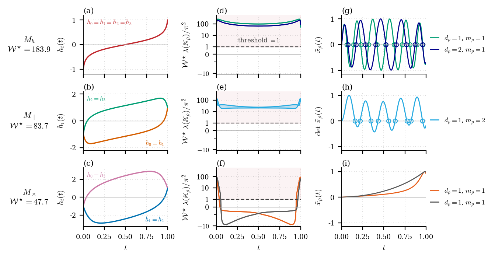
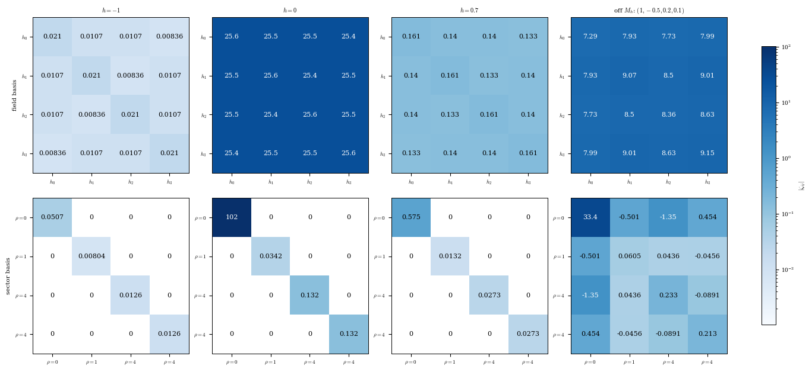

# ExtrinsicThermodynamicGeometry

Code supporting *Extrinsic thermodynamic geometry, symmetry, and the cost of constraint* (J.R. Sawchuk & D.A. Sivak). 

## Files

`symmetry.py` - Markov graph and its symmetries
- `ColouredGraph` : edge-coloured Markov graph. Attribute `.aut` is its automorphism group $\mathrm{Aut}(G)$
- `stabilizer`, `orbits` : subgroup that fixes given distributions (e.g. the endpoints of a protocol), and the orbits of a group
- `real_character_table` : real irreducible characters of a group, built from complex characters computed with GAP
- `sector_projectors`, `sector_basis` : multiplicities $m_{\rho}$ of the sectors, the projectors $\Pi_{\rho}$, and a basis of each sector
- `induced_representation` : action $S_{\sigma} = B^+ P_{\sigma} B$ of a group on control coordinates 

`models.py` - Builds Markov models on ColouredGraph objects
- `glauber`, `power_law` : example rate laws, given as functions $w(y)$ of $y = \pi_{\rm target} / \pi_{\rm source}$
- `markov_graph`, `spin_system` : a Markov graph together with its rate laws, constructor for building spin systems 
- `rate_matrix`, `laplacian` : $\mathbb{W}(pi)$ and $L(\pi)$ 
- `equilibrium`, `chart_jacobian`, `coordinates` : $\pi(u) \propto \exp(\theta_0 + Bu)$ given $B$, $\theta_0$, $\mathbb{J} = \partial \pi / \partial u$, inverse of equilibrium chart ($\pi \to u$)

`geometry.py` — thermodynamic geometry
- `simplex_metric`, `control_set_metric` : the friction metric on the simplex and on a control set
- `christoffel`, `riemann`, `curvature_form`, `second_fundamental_form` : connection and curvature, with the conventions of App. A of the paper
- `parallel_frames`, `sector_curvature`, `scaled_curvature` : $\mathbb{K}_{\rho}(s)$ along a protocol, used in the thermodynamic comparison theorem and integration of the Jacobi equation
- `jacobi_determinant`, `conjugate_points` : direct integration of the sector Jacobi equation and identification of conjugate points 

## Dependencies

Python ≥ 3.11.

    pip install numpy scipy networkx matplotlib jax

Automorphism groups are computed with SageMath, and stabilizers, conjugacy classes, and character tables with GAP through Sage. Both can be installed from the modular [passagemath](https://passagemath.org) distribution:

    pip install passagemath-gap passagemath-graphs passagemath-modules passagemath-flint passagemath-pari

The example below also requires Pandas to read the optimal protocols of the four-spin control-set survey from `allProtocols.pkl`, available at [Zenodo 10.5281/zenodo.15678284](https://doi.org/10.5281/zenodo.15678284). 

## Example: field control of four spins

We reproduce the field-control example of the paper. The task is to reverse the magnetization of four Ising spins on a $2 \times 2$ grid with Glauber dynamics.


```python
import pickle
import numpy as np
import matplotlib.pyplot as plt
import networkx as nx

from symmetry import *
from models import *
from geometry import *
```

### 1. Model and dynamical symmetries

`spin_system(4)` builds the Markov graph of four spins with single spin-flip Glauber dynamics (rate law $w(y) = y/(1+y)$ with $y = \pi_{\rm target} / \pi_{\rm source}$). Its 16 states are the spin configurations, and the graph is the four-dimensional hypercube.

`G.aut` returns the automorphism group of the Markov graph with its edges coloured by rate law $\mathrm{Aut}(G)$ as a permutation group on the state indices. Here every edge has the same colour, and the group has $4!\times 2^4 = 384$ elements, the signed permutations of four elements.


```python
G = spin_system(4)                      # four spins; every single-spin flip obeys the Glauber rate law
AutG = G.aut                               # Aut(G), the group of dynamical symmetries
print(f"{G.n} states, {len(G.edges)} edges, |Aut(G)| = {AutG.order()}\n")


# A dynamical symmetry maps the rate matrix at pi to the rate matrix at the permuted distribution
pi = np.random.default_rng(0).random(G.n)
pi = pi / pi.sum()
sigma = elements(AutG)[100]
P = perm_matrix(sigma)
print("sigma =", cycle_notation(sigma))
print("largest entry of W(P pi) - P W(pi) P^T:", float(abs(rate_matrix(G, P @ pi) - P @ rate_matrix(G, pi) @ P.T).max()))


# Spins with different bare rates are distinguishable, and the group is smaller
G_two_rates = spin_system(4, [glauber(1.0), glauber(1.0), glauber(2.0), glauber(2.0)])
print("\ntwo fast and two slow spins: |Aut(G)| =", G_two_rates.aut.order())


#  G.to_nx() converts to a networkx graph, which is useful for plotting 
fig, axes = plt.subplots(1, 2, figsize=(10, 5))
for ax, graph in zip(axes, [G, G_two_rates]):
    nx_graph = graph.to_nx()
    edge_colours = [f"C{colour}" for _, _, colour in nx_graph.edges(data="colour")]
    nx.draw(nx_graph, ax=ax, pos=nx.kamada_kawai_layout(nx_graph.to_undirected()), arrows=False,
            edge_color=edge_colours, node_color="white", edgecolors="black", with_labels=True)
```

    16 states, 32 edges, |Aut(G)| = 384
    
    sigma = (0 4 5 1)(2 12 7 9)(3 8 6 13)(10 14 15 11)
    largest entry of W(P pi) - P W(pi) P^T: 4.440892098500626e-16
    
    two fast and two slow spins: |Aut(G)| = 64


    

    


### 2. Symmetries and control sets

A control set is specified by two arrays: the conjugate force matrix $B$, with elements $B_{\mu i} = - \partial V_\mu / \partial u_i$, and $\theta_0$, the part of the state energies the controller cannot change. For spins, `field_basis` and `coupling_basis` return the columns of $B$ conjugate to the local fields $h_j$ and pair couplings $J_{jk}$.

The task is to reverse the magnetization of a $2\times2$ ferromagnetic spin system, labelled $0\,1$ on the top row and $2\,3$ on the bottom, by taking every field from $-1$ to $+1$. The controller can adjust the four local fields, and the nearest-neighbour couplings are fixed at $J_{\rm NN}=1$, defining the control set $M_{h_i}$.

$H \subseteq \mathrm{Aut}(G)$ is the group of dynamical symmetries that fix both endpoints of the task, and $\mathrm{Aut}(G, M_{h_i}) \subseteq \mathrm{Aut}(G)$ is the stabilizer subgroup of $M_{h_i}$. 

The endpoint stabilizer $H$ is the dihedral group $D_4$, the eight symmetries of the square, and $\mathrm{Aut}(G, M_{h_i})$ is $C_2 \times D_4$, containing the reversal of all four spins (which exchanges the two endpoints) in addition to the symmetries of the square:


```python
B_hi   = field_basis(4)                                                      # M_hi: the four local fields h_0, ..., h_3
theta0 = coupling_basis(4, [(0, 1), (0, 2), (1, 3), (2, 3)]) @ np.ones(4)    # nearest-neighbour couplings J = 1, not controlled

pi_0 = equilibrium(-np.ones(4), B_hi, theta0)                            # all fields at -1
pi_1 = equilibrium(+np.ones(4), B_hi, theta0)                            # all fields at +1

H = stabilizer(AutG, pi_0, pi_1)                                          # dynamical symmetries fixing both endpoints
S_hi, Aut_hi = control_set_symmetries(AutG, B_hi, theta0)                 # Aut(G, M_hi) and its action S on the fields
print("endpoint stabilizer H:", H.structure_description(), "of order", H.order(), "with", len(orbits(H)), "orbits")
print("Aut(G, M_hi):", Aut_hi.structure_description(), "of order", Aut_hi.order(), "with", len(orbits(Aut_hi)), "orbits")
```

    endpoint stabilizer H: D4 of order 8 with 6 orbits
    Aut(G, M_hi): C2 x D4 of order 16 with 4 orbits


#### Symmetric control sets

Reducing the resolution of control to one field per row ($M_\parallel$), or one field per diagonal ($M_\times$) defines submanifolds of $M_{h_i}$, each a set of distributions fixed by some subgroup of $H$ and hence totally geodesic in $M_{h_i}$. The function `is_totally_geodesic(H, B_{M}, B_{M'})` checks this for $M \subseteq M'$ and finds the subgroup of $H$ under which $M$ is fixed.


```python
partitions = {"M_h":   [[0, 1, 2, 3]],                                       # one global field
              "M_par": [[0, 1], [2, 3]],                                     # one field per row
              "M_x":   [[0, 3], [1, 2]]}                                     # one field per diagonal

control_sets, groups = {}, {}
for name, partition in partitions.items():
    control_sets[name] = np.column_stack([B_hi[:, block].sum(axis=1) for block in partition])
    certified, groups[name] = is_totally_geodesic(AutG, control_sets[name], B_hi, theta0)
    print(f"{name:6s} fixed by {groups[name].structure_description():8s} totally geodesic in M_hi: {certified}")
```

    M_h    fixed by D4       totally geodesic in M_hi: True
    M_par  fixed by C2       totally geodesic in M_hi: True
    M_x    fixed by C2 x C2  totally geodesic in M_hi: True


#### Full control

Without constraints, the symmetric control set is $M_H$, the set of all distributions that are uniform on each orbit of $H$. `orbit_control_subset(H)` returns the conjugate force matrix $B$ for this submanifold, whose columns are the orbit indicators, less one column so that $B$ is full rank. The endpoint stabilizer $H \cong D_4$ has six orbits, so $M_H$ is a five-parameter control set, and it is totally geodesic in the simplex $\Delta^{15}$. 

`coordinate_symmetry_constraints` gives the constraints on the couplings $h_i$, $J_{ij}$, $K_{ijk}$, $Q$, showing that the uniform field $h$, the nearest-neighbour coupling $J_{\rm NN}$, the diagonal coupling $J_{\rm NNN}$, the three-spin coupling $K$, and the four-spin coupling $Q$ span the symmetric submanifold. Note that the function currently only works when the induced representation of the group on the parameters is given by signed permutation matrices.


```python
B_H = orbit_control_subset(H)

print("M_H has dimension", B_H.shape[1], 
      "and is totally geodesic in the simplex:", is_totally_geodesic(AutG, B_H, full_control_basis(4))[0])

"""Names of the coordinates of full_control_basis, in the same order: h0, ..., J01, ..., K012, ..., Q0123."""
def full_control_names(n_spins):
    letter = {1: "h", 2: "J", 3: "K", 4: "Q"}
    return [letter.get(size, "u") + "".join(str(j) for j in spins)
            for size in range(1, n_spins + 1) for spins in combinations(range(n_spins), size)]

relations = coordinate_symmetry_constraints(H, full_control_basis(4), names=full_control_names(4))
print("\nCoordinate constraints under D4:\n", "\n".join(relations))
```

    M_H has dimension 5 and is totally geodesic in the simplex: True
    
    Coordinate constraints under D4:
     h0 = h1 = h2 = h3
    J01 = J02 = J13 = J23
    J03 = J12
    K012 = K013 = K023 = K123
    Q0123 free


### 3. Symmetry sectors

Along a protocol with symmetry group $K$, the perturbations available to the controller split into *sectors* (or *isotypic components*), one for each real irreducible representation $\rho$ of $K$. $\rho = 0$ is the trivial representation and its sector is tangent to the symmetric control set. The sectors $\rho \neq 0$ are the symmetry-breaking sectors.

`control_set_sectors(K, B, theta0)` returns the sectors of the control coordinates as a list indexed by $\rho$. Each entry gives the irrep dimension $d_{\rho}$, multiplicity $m_{\rho}$, projector $\Pi_{\rho}$, and a basis of the sector. The indexing of $\rho$ follows the rows of `real_character_table`. 

First, two helper functions for printing the results: `pattern` and `print_sectors`.


```python
def pattern(vector, names):
    """A sector basis vector as a combination of named coordinates, e.g. 'h0 - h1 - h2 + h3'."""
    scaled = np.round(vector / np.abs(vector).max(), 2)
    text = ""
    for coefficient, name in zip(scaled, names):
        if coefficient != 0:
            sign = " - " if coefficient < 0 else " + "
            size = "" if abs(coefficient) == 1 else f"{abs(coefficient):g} "
            text += sign + size + name
    return text[3:] if text.startswith(" + ") else "-" + text[3:]

def print_sectors(title, sector_list, names):
    """Table of sectors: rho, irrep dimension d, multiplicity m, and one basis pattern per line."""
    print(f"\n{title}\n  rho  d  m")
    for rho, sector in enumerate(sector_list):
        kind = "symmetric" if rho == 0 else ("symmetry-breaking" if sector["m"] > 0 else "not present")
        patterns = [pattern(column, names) for column in sector["basis"].T] or [""]
        print(f"  {rho:>3}  {sector['d']}  {sector['m']}  {kind:18s} {patterns[0]}")
        for extra in patterns[1:]:
            print(f"{'':31s} {extra}")
```

Below: the sectors of the four fields under the symmetry group of each control set. Each pattern is a perturbation of the fields, so `h0 - h1 - h2 + h3` corresponds to perturbations proportional to $(1,-1,-1,1)$ (increases the fields along one diagonal and decreases them along the other).

For $M_h$, $\rho=1$ and $\rho=4$ correspond to the sectors $\mathcal{U}_1$ and $\mathcal{U}_2$ of the paper. The sectors are different for the submanifolds $M_\parallel$ and $M_\times$ fixed by smaller groups: the symmetric sector is two dimensional, leaving one symmetry-breaking sector with $m_\rho=2$ for $M_\parallel$ and two one-dimensional sectors for $M_\times$. 

A row with $m_\rho=0$ is an irrep of the group that does not occur among the fields.


```python
field_sectors = {}
for name, K in groups.items():
    field_sectors[name] = control_set_sectors(K, B_hi, theta0)
    print_sectors(f"{name} in M_hi: group {K.structure_description()}", field_sectors[name], ["h0", "h1", "h2", "h3"])
```

    
    M_h in M_hi: group D4
      rho  d  m
        0  1  1  symmetric          h0 + h1 + h2 + h3
        1  1  1  symmetry-breaking  h0 - h1 - h2 + h3
        2  1  0  not present        
        3  1  0  not present        
        4  2  1  symmetry-breaking  h0 - h3
                                    h1 - h2
    
    M_par in M_hi: group C2
      rho  d  m
        0  1  2  symmetric          h0 + h1
                                    h2 + h3
        1  1  2  symmetry-breaking  h0 - h1
                                    h2 - h3
    
    M_x in M_hi: group C2 x C2
      rho  d  m
        0  1  2  symmetric          h0 + h3
                                    h1 + h2
        1  1  1  symmetry-breaking  h0 - h3
        2  1  1  symmetry-breaking  h1 - h2
        3  1  0  not present        


The sector decomposition of $\mathbb{R}^{15}$ (all 15 fields and couplings) for $H\cong D_4$ gives the same five constraints for the symmetric sector as in Section 2 above, and the symmetry-breaking sectors have $(d_\rho, m_\rho) = (1,3)$, $(1,1)$ and $(2,3)$, ten directions in all, which span the normal space of $M_H$ in $\Delta^{15}$.

Observe that the sector $\rho=2$ contains only `J01 - J02 - J13 + J23`, which alternates the couplings between horizontal and vertical bonds, and is therefore inaccessible to a controller with fields alone. The irrep $\rho=3$ does not occur even under full control.


```python
full_sectors = control_set_sectors(H, full_control_basis(4))
print_sectors(f"M_H under full control: group {H.structure_description()}", full_sectors, full_control_names(4))
```

    
    M_H under full control: group D4
      rho  d  m
        0  1  5  symmetric          h0 + h1 + h2 + h3
                                    J01 + J02 + J13 + J23
                                    J03 + J12
                                    K012 + K013 + K023 + K123
                                    Q0123
        1  1  3  symmetry-breaking  h0 - h1 - h2 + h3
                                    J03 - J12
                                    K012 - K013 - K023 + K123
        2  1  1  symmetry-breaking  J01 - J02 - J13 + J23
        3  1  0  not present        
        4  2  3  symmetry-breaking  h0 - h3
                                    h1 - h2
                                    J01 - J23
                                    J02 - J13
                                    K012 - K123
                                    K013 - K023


### 4. Curvature along optimal protocols

Optimal protocols are from [*4 spin system protocols and spectra* (Zenodo)](https://doi.org/10.5281/zenodo.15678284). Each row of `allProtocols.pkl` holds, for one control set, the state energies $V(t)$ on 251 uniformly spaced times and the optimal excess work $\mathscr{W}^\star$. The rows are selected by the field partitions that defined the control sets, and `coordinates` converts $\pi(t)\propto e^{-V(t)}$ to the fields $h_i(t)$.

The symmetry group of a protocol is the group that fixes every distribution along it. The cell below confirms the symmetry groups used to compute the sectors of Section 3 above.


```python
data = pickle.load(open("fourSpinData/allProtocols.pkl", "rb")) 

protocols = {}
for name, partition in partitions.items():
    row = next(row for _, row in data.iterrows() if row["cSet"] == partition)
    V = np.asarray(row["V(t)"], float)                                       # state energies V(t), shape (251, 16)
    weights = np.exp(-(V - V.min(axis=1, keepdims=True)))
    distributions = weights / weights.sum(axis=1, keepdims=True)             # pi(t), proportional to exp(-V(t))
    protocols[name] = {"times": np.linspace(0, 1, len(V)),
                       "path": np.array([coordinates(pi, B_hi, theta0) for pi in distributions]),   # fields h_i(t)
                       "W": float(row["Work"])}                         

    # The symmetry group of the protocol is the stabilizer of every distribution along it
    protocol_group = stabilizer(Aut_hi, *distributions)
    same_group = protocol_group.order() == groups[name].order() and protocol_group.is_subgroup(groups[name])
    print(f"{name:6s} W* = {protocols[name]['W']:6.1f}   symmetry group {protocol_group.structure_description():8s}")
```

    M_h    W* =  183.9   symmetry group D4      
    M_par  W* =   83.7   symmetry group C2      
    M_x    W* =   47.7   symmetry group C2 x C2 


#### Comparison theorem and conjugate points

* `control_set_metric` returns the friction tensor on $M_{h_i}$ as a function of the fields
* `parallel_frames` builds an orthonormal frame of the sector at $t=0$ and parallel transports it along the protocol
* `sector_curvature` evaluates the sector curvature operator $\mathbb{K}_\rho(t)$ in that frame
* `scaled_curvature` returns the eigenvalues of $\mathbb{K}_\rho(t)$ multiplied by $\mathscr{W}^\star/\pi^2$ 
* `jacobi_determinant` integrates the sector Jacobi equation $\ddot{x} + \mathscr{W}^\star\mathbb{K}_\rho(t)\,x = 0$ 
* `conjugate_points` returns the times at which the Jacobi determinant changes sign 

For a sector with $d_\rho > 1$ and $m_\rho = 1$, $\mathbb{K}_\rho$ is a multiple of the identity. `reduce_sector_curvature` reduces it to that single number, and each conjugate point then counts $d_\rho$ times.


```python
zeta = control_set_metric(G, B_hi, theta0)                                   # friction tensor on M_hi in the coordinates h_i

results = {}
for name, protocol in protocols.items():
    times, path, W = protocol["times"], protocol["path"], protocol["W"]
    breaking = [sector for rho, sector in enumerate(field_sectors[name]) if rho > 0 and sector["m"] > 0]

    frames = parallel_frames(zeta, times, path, [sector["basis"] for sector in breaking])
    curvatures = sector_curvature(zeta, times, path, frames)                 # K_rho(t) for each symmetry-breaking sector

    results[name] = []
    for sector, curvature in zip(breaking, curvatures):
        scaled = scaled_curvature(curvature, W)                              # W* eigenvalues(K_rho(t)) / pi^2
        reduced = reduce_sector_curvature(curvature, sector["d"], sector["m"])
        t, sign, log_abs = jacobi_determinant(times, reduced, W)
        results[name].append({"d": sector["d"], "m": sector["m"], "scaled": scaled,
                              "t": t, "determinant": sign * np.exp(log_abs - np.nanmax(log_abs[1:])),
                              "conjugate": conjugate_points(t, sign, log_abs)})

    if all(result["scaled"].max() < 1 for result in results[name]):
        verdict = "local minimum"
    elif any(result["scaled"].min() > 1 for result in results[name]):
        verdict = "saddle point"
    else:
        verdict = "inconclusive"
    print(f"\n{name}: W* = {W:.1f} (integrated along the path: {excess_work(zeta, times, path):.1f}); comparison theorem: {verdict}")
    for result in results[name]:
        points = result["conjugate"]
        first = f", first at t = {points[0]:.3f}" if points else ""
        print(f"   sector d = {result['d']}, m = {result['m']}: scaled curvature between {result['scaled'].min():.1f} and "
              f"{result['scaled'].max():.1f}; {len(points)} conjugate points{first}")
```

    
    M_h: W* = 183.9 (integrated along the path: 183.6); comparison theorem: saddle point
       sector d = 1, m = 1: scaled curvature between 53.6 and 262.5; 11 conjugate points, first at t = 0.064
       sector d = 2, m = 1: scaled curvature between 64.6 and 210.2; 9 conjugate points, first at t = 0.074
    
    M_par: W* = 83.7 (integrated along the path: 83.6); comparison theorem: saddle point
       sector d = 1, m = 2: scaled curvature between 18.6 and 133.8; 9 conjugate points, first at t = 0.159
    
    M_x: W* = 47.7 (integrated along the path: 47.7); comparison theorem: inconclusive
       sector d = 1, m = 1: scaled curvature between -7.7 and 87.9; 0 conjugate points
       sector d = 1, m = 1: scaled curvature between -7.7 and 87.9; 0 conjugate points


The global-field protocol and the row-field protocol are saddle points of the excess work in $M_{h_i}$, so refining the control lowers the cost in both cases. For the diagonal-field protocol the comparison theorem is inconclusive, because the curvature is negative over most of the protocol but exceeds the threshold near the endpoints, but direct integration of the Jacobi equation confirms that this protocol is a local minimum, consistent with its excess work being equal to that of full field control.


```python
TEX_NAME       = {"M_h": r"$M_h$", "M_par": r"$M_\parallel$", "M_x": r"$M_\times$"}
FIELD_COLOURS  = {"M_h": ["#C1272D"], "M_par": ["#D55E00", "#009E73"], "M_x": ["#CC79A7", "#0072B2"]}    # one per group of tied fields
SECTOR_COLOURS = {"M_h": ["#009E73", "#00008B"], "M_par": ["#27AAE1"], "M_x": ["#E8601C", "#5A5A5A"]}   # one per symmetry-breaking sector
FIELD_LIMITS   = {"M_h": (-1.2, 1.2), "M_par": (-2.2, 2.2), "M_x": (-3.3, 3.3)}
STYLE = {"font.family": "serif", "mathtext.fontset": "cm", "axes.unicode_minus": False, "font.size": 7,
         "axes.labelsize": 7.5, "axes.titlesize": 7.5, "legend.fontsize": 6.5, "xtick.labelsize": 6.5,
         "ytick.labelsize": 6.5, "axes.linewidth": 0.7, "pdf.fonttype": 42}

def style_axis(ax, letter):
    ax.set_title(f"({letter})", loc="left", pad=2)
    ax.grid(True, ls=(0, (1, 3)), lw=0.6, color="0.55", alpha=0.4, zorder=0)
    ax.set_xlim(0, 1); ax.set_xticks([0, 0.25, 0.5, 0.75, 1])
    ax.spines[["top", "right"]].set_visible(False)

with plt.rc_context(STYLE):
    fig, axes = plt.subplots(3, 4, figsize=(6.6, 3.4), sharex="col", layout="constrained",
                             gridspec_kw={"width_ratios": [0.22, 1, 1, 1]}, dpi=200)

    for row, name in enumerate(results):
        times, path, W = protocols[name]["times"], protocols[name]["path"], protocols[name]["W"]

        # Column 0: the control set and the excess work of its optimal protocol
        ax = axes[row, 0]; ax.axis("off")
        ax.text(0.5, 0.5, TEX_NAME[name] + "\n" + rf"$\mathcal{{W}}^\star = {W:.1f}$", ha="center", va="center", fontsize=8)

        # Column 1, panels (a)-(c): the optimal protocol, one curve for each group of tied fields
        ax = axes[row, 1]
        upper = max(partitions[name], key=lambda block: path[:, block[0]].mean())        # the curve labelled at the top left
        for block, colour in zip(partitions[name], FIELD_COLOURS[name]):
            ax.plot(times, path[:, block[0]], color=colour, lw=1.2)
            label = "$" + " = ".join(f"h_{j}" for j in block) + "$"
            corner = {"xy": (0.04, 0.94), "ha": "left", "va": "top"} if block == upper else {"xy": (0.96, 0.06), "ha": "right", "va": "bottom"}
            ax.annotate(label, xycoords="axes fraction", fontsize=6, color=colour, **corner)
        ax.axhline(0, color="0.75", lw=0.5); ax.set_ylim(*FIELD_LIMITS[name]); ax.set_ylabel("$h_i(t)$")
        style_axis(ax, "abc"[row])

        # Column 2, panels (d)-(f): extreme scaled curvatures of each sector against the threshold 1 of the comparison theorem
        ax = axes[row, 2]
        for result, colour in zip(results[name], SECTOR_COLOURS[name]):
            smallest, largest = result["scaled"].min(axis=1), result["scaled"].max(axis=1)
            ax.plot(times, smallest, color=colour, lw=1.0); ax.plot(times, largest, color=colour, lw=1.0)
            ax.fill_between(times, smallest, largest, color=colour, alpha=0.25, lw=0)     # empty when the two coincide
        ax.axhspan(1, 1e4, color="#C1272D", alpha=0.05, zorder=0)
        ax.axhline(1, color="0.25", ls=(0, (4, 2)), lw=0.8); ax.axhline(0, color="0.7", lw=0.5)
        ax.set_yscale("symlog", linthresh=1, linscale=0.6); ax.set_ylim(-12, 600)        # linear between -1 and 1, logarithmic outside
        ax.set_yticks([-10, 0, 1, 10, 100]); ax.set_yticklabels(["$-10$", "0", "1", "10", "100"])
        ax.set_ylabel(r"$\mathcal{W}^\star\,\lambda(\mathbb{K}_\rho)/\pi^2$")
        style_axis(ax, "def"[row])

        # Column 3, panels (g)-(i): normalized Jacobi determinant of each sector, with circles at its conjugate points
        ax = axes[row, 3]
        for result, colour in zip(results[name], SECTOR_COLOURS[name]):
            ax.plot(result["t"], result["determinant"], color=colour, lw=1.0, label=rf"$d_\rho={result['d']}$, $m_\rho={result['m']}$")
            ax.plot(result["conjugate"], np.zeros(len(result["conjugate"])), "o", mfc="none", color=colour, ms=4, mew=0.8)
        scalar = all(result["m"] == 1 for result in results[name])                        # then the Jacobi equation is a scalar equation
        ax.set_ylabel(r"$\tilde{x}_\rho(t)$" if scalar else r"$\det\,\tilde{\mathbb{x}}_\rho(t)$")
        ax.axhline(0, color="0.7", lw=0.5); ax.set_ylim(-1.15, 1.15); ax.set_yticks([-1, 0, 1])
        ax.legend(frameon=False, loc="center left", bbox_to_anchor=(1.0, 0.5), handlelength=1.3, borderaxespad=0.2)
        style_axis(ax, "ghi"[row])

    axes[0, 2].annotate("threshold $=1$", xy=(0.5, 2.4), fontsize=6, color="0.25", ha="center")
    for ax in axes[-1, 1:]:
        ax.set_xlabel("$t$")
plt.show()
```


    

    


### Checks

Two direct confirmations of the symmetry results above.

**Second fundamental form.** `second_fundamental_form(metric_M, metric_ambient, embedding, u)` evaluates $\mathrm{I\!I}$ of a submanifold $M$ in an ambient manifold at the coordinates $u$ of $M$; `embedding` maps $u$ to the ambient coordinates of the same point. $\mathrm{I\!I} \equiv 0$ if and only if $M$ is totally geodesic. 


```python
metric_simplex = simplex_metric(G)                                           # Delta^15 with the friction metric, coordinates pi
test_points = {"M_h": [[-1.0], [-0.3], [0.5]], "M_par": [[-0.3, 0.5]], "M_x": [[-0.3, 0.5]]}      # coordinates u on each control set

for name, partition in partitions.items():
    B_M = control_sets[name]
    metric_M = control_set_metric(G, B_M, theta0)                            # M with its inherited metric, coordinates u
    tie = jnp.array([[float(j in block) for block in partition] for j in range(4)])     # h_j = u_block for every j in the block
    into_fields = lambda u: tie @ u                                          # M -> M_{h_i}: u -> (h_0, h_1, h_2, h_3)
    into_simplex = lambda u: equilibrium(u, B_M, theta0)                     # M -> Delta^15: u -> pi(u)
    for u in test_points[name]:
        u = jnp.array(u)
        II_fields = second_fundamental_form(metric_M, zeta, into_fields, u)
        II_simplex = second_fundamental_form(metric_M, metric_simplex, into_simplex, u)
        print(f"{name:5s} u = {np.round(np.asarray(u), 2)}:  max |II| in M_hi = {float(jnp.abs(II_fields).max()):.1e},  in Delta^15 = {float(jnp.abs(II_simplex).max()):.3f}")
```

    M_h   u = [-1.]:  max |II| in M_hi = 3.0e-14,  in Delta^15 = 0.036
    M_h   u = [-0.3]:  max |II| in M_hi = 7.7e-13,  in Delta^15 = 24.485
    M_h   u = [0.5]:  max |II| in M_hi = 1.7e-13,  in Delta^15 = 4.429
    M_par u = [-0.3  0.5]:  max |II| in M_hi = 2.7e-12,  in Delta^15 = 13.669
    M_x   u = [-0.3  0.5]:  max |II| in M_hi = 3.5e-11,  in Delta^15 = 10.262


**Block-diagonalization of the friction tensor.** At a point of $M_h$, the friction tensor $\zeta$ on $M_{h_i}$ is invariant under the induced action of $\mathrm{Aut}(G, M_h) \cong D_4$, so in a sector basis it is block diagonal. Below, $\zeta$ is shown in the field coordinates $h_0,\dots,h_3$ (top) and in the sector basis (bottom) at three points of $M_h$ and at one point off it. Shading is by $\log |\zeta_{ij}|$. 


```python
from matplotlib.colors import LogNorm

sectors_h = field_sectors["M_h"]                                             # sectors of the four fields under Aut(G, M_h) = D4
present = [rho for rho, sector in enumerate(sectors_h) if sector["m"] > 0]
Q = np.column_stack([sectors_h[rho]["basis"] for rho in present])            # sector basis: columns ordered by rho, the symmetric sector first
sector_labels = [rf"$\rho={rho}$" for rho in present for _ in range(sectors_h[rho]["d"] * sectors_h[rho]["m"])]
field_labels = [f"$h_{j}$" for j in range(4)]

points = {"$h = -1$": -np.ones(4), "$h = 0$": np.zeros(4), "$h = 0.7$": 0.7 * np.ones(4),
          "off $M_h$: $(1, -0.5, 0.2, 0.1)$": np.array([1.0, -0.5, 0.2, 0.1])}
metrics = [np.asarray(zeta(u)) for u in points.values()]                   
largest = max(np.linalg.norm(metric, 2) for metric in metrics)            
shade = LogNorm(vmin=1e-5 * largest, vmax=largest)                         

fig, axes = plt.subplots(2, len(points), figsize=(3.4 * len(points), 6.2), layout="constrained")
for column, (title, metric) in enumerate(zip(points, metrics)):
    for row, (matrix, labels) in enumerate([(metric, field_labels), (Q.T @ metric @ Q, sector_labels)]):
        matrix = np.where(np.abs(matrix) > 1e-10 * largest, matrix, 0.0)     # round-off is displayed as 0
        ax = axes[row, column]
        image = ax.imshow(np.ma.masked_equal(np.abs(matrix), 0), cmap="Blues", norm=shade)      # zero entries are left white
        for (i, j), value in np.ndenumerate(matrix):
            ax.text(j, i, f"{value:.3g}", ha="center", va="center", fontsize=8,
                    color="white" if value != 0 and shade(abs(value)) > 0.6 else "black")
        ax.set_xticks(range(4), labels); ax.set_yticks(range(4), labels)
    axes[0, column].set_title(title)
axes[0, 0].set_ylabel("field basis"); axes[1, 0].set_ylabel("sector basis")
fig.colorbar(image, ax=axes, label=r"$|\zeta_{ij}|$", shrink=0.8)
plt.show()
```


    

    


## References
- The Sage Developers, *SageMath, the Sage Mathematics Software System (Version 10.x)*, https://www.sagemath.org, DOI 10.5281/zenodo.8042260.
- The GAP Group, *GAP – Groups, Algorithms, and Programming, Version 4.14.0*, 2024, https://www.gap-system.org.
- J. Sawchuk, *4 spin system protocols and spectra*, Zenodo (2025), doi:10.5281/zenodo.15678284.
