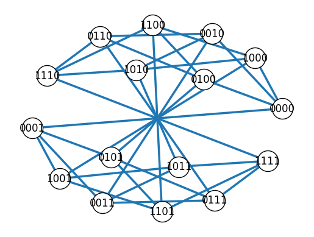

# ExtrinsicThermodynamicGeometry

Code supporting *Extrinsic thermodynamic geometry, symmetry, and the cost of constraint* (J.R. Sawchuk & D.A. Sivak). Notation follows the paper: states $\mu \in \Omega$, equilibrium distribution $\pi$ on the open simplex $\Delta^n$, Laplacian $L = \mathbb{W}D_{\pi}$, friction metric $L^+$, excess work functional $\mathscr{W}$, accessible symmetry sectors $\mathcal{U}_\rho$ with irrep dimension $d_{\rho}$ and multiplicity $m_{\rho}$, and sector curvature operators $\mathbb{K}_\rho$.

## Files

`symmetry.py` - symmetries of the Markov graph and their representations.
- `ColouredGraph` : the edge-coloured Markov graph and its automorphism group $\mathrm{Aut}(G)$ (`.aut`), computed with SageMath and returned as a permutation group on the state indices.
- `stabilizer` : the subgroup fixing given distributions, e.g. the endpoints of a protocol, or every point along it, from which `orbits` returns the orbits of the group.
- `Sectors` : the decomposition of a representation into the sectors $\mathcal{U}_{\rho}$ of a group, built from its character table with GAP. For each sector, returns the projector, an orthonormal basis, and the irrep dimension and multiplicity.
- `induced_representation` : computes $S_{\sigma} = B^+ P_{\sigma} B$, the action of a group on the coordinates of a control set 

`models.py` - Markov models and control sets.
- Rate laws as conductance functions; builds coloured graphs with the `Model` class, which also returns the rate matrix, Laplacian, and metric
- `ControlSet` : defines a control set from the chart $\pi(u) = \mathrm{softmax}(\theta_0 + Bu)$, with $B$ the matrix of forces conjugate to the controls $u$ and $\theta_0$ a fixed background. $\theta_0$ must be orthogonal to the columns of $B$ so that symmetries act linearly on $u$. 
    - `.symmetry_group` : the stabilizer of the control set and its action on the parameters
    - `.sectors` : the sector decomposition of the control space
    - `.fixed` : symmetric submanifold
- `is_totally_geodesic` : returns True if $M$ is the entire fixed-point set of a group of isometries of $M'$ and False otherwise
- `spin_system`, `field_basis`, `coupling_basis`, `spin_full_control` : $n$-spin model and associated functions for defining control sets 

`geometry.py` — Riemannian geometry of the thermodynamic manifold and the comparison theorem
- `SimplexGeometry`, `ControlGeometry` : simplex w/ the friction metric $L^+$ and a control set with the inherited metric $\mathbb{J}^{\sf T}L^+ \mathbb{J}$. Christoffel symbols and the Riemann tensor are obtained by forward-mode automatic differentiation in JAX, with the conventions of Appendix A from the paper.
- `K_blocks`, `K_along_path` : sector curvature operators at a point or along a discretized protocol. `parallel_frames` transports the frames, and `reduced_curvature` returns the eigenvalues of $\mathbb{K}_{\rho}$ scaled by $\mathscr{W}^\star / \pi^2$ for the comparison theorem tests.
- `sector_jacobi` : integrates $\ddot{X}_{\rho} + \mathscr{W}^\star \mathbb{K}_{\rho}(t) X_{\rho} = 0$ with initial conditions $X_{\rho}(0) = 0$, $\dot{X}_{\rho}(0) = I$ by fourth-order Runge-Kutta, with periodic QR re-normalization to keep $X_{\rho}$ well-conditioned. Locates conjugate points as sign changes of $\mathrm{det}(X_{\rho})$. Sectors with both $d_{\rho} > 1$ and $m_{\rho} > 1$ are out of scope. This case is not necessary for the paper, but the code should be generalized to address this in future iterations.

## Dependencies

Python ≥ 3.11.

    pip install numpy scipy networkx matplotlib jax

Graph automorphism groups are computed with SageMath, and stabilizers, conjugacy classes, and character tables with GAP through Sage. Both can be installed from the modular [passagemath](https://passagemath.org) distribution, so no full Sage install is needed:

    pip install passagemath-gap passagemath-graphs passagemath-modules passagemath-flint passagemath-pari

The example below also requires Pandas to read the optimal protocols of the four-spin control-set survey from `allProtocols.pkl`. The data is available at [Zenodo 10.5281/zenodo.15678284](https://doi.org/10.5281/zenodo.15678284). 

## Example: field control of four spins

The remainder of this notebook reproduces the field-control example of the paper. The task is to reverse the magnetization of four Ising spins on a $2 \times 2$ grid with Glauber dynamics.


```python
import pickle
import numpy as np
import jax.numpy as jnp
import matplotlib.pyplot as plt

from symmetry import stabilizer, orbits, plot_graph
from models import glauber, spin_system, field_basis, coupling_basis, spin_full_control, ControlSet, fixed_manifold, is_totally_geodesic
from geometry import ControlGeometry, SimplexGeometry, second_fundamental_form, parallel_frames, K_along_path, reduced_curvature, sector_jacobi
```

### Model and dynamical symmetries

`spin_system(n, law)` builds the $2^n$-state single-spin-flip model. States are bit strings, edges connect states differing by one bit, and each edge carries the rate law of the spin it flips. Below the colouring is trivial, with Glauber conductances $c_{\mu\nu} = \pi_\mu\pi_\nu/(\pi_\mu + \pi_\nu)$ on every edge. The function can be called with a list of $n$ laws, which colours the edges and reduces the automorphism group accordingly. 

`model.G` is the edge-coloured Markov graph, here the tesseract, and `model.G.aut` its coulor-preserving automorphism group as a permutation group on the state indices. Here the group is the hyperoctahedral group of order $4!\,2^4 = 384$.


```python
n_spins = 4
model = spin_system(n_spins, glauber(1))
AutG = model.G.aut

print("|Aut(G)| =", AutG.order())
plot_graph(model.G);
```

    |Aut(G)| = 384


    

    


### Control sets

A control set is a chart $\pi(u) = \mathrm{softmax}(\theta_0 + Bu)$: column $j$ of $B$ is the state-energy perturbation conjugate to the control coordinate $u^j$, and $\theta_0$ is a fixed background. `field_basis` and `coupling_basis` return the spin monomials $\sigma_i$ and $\sigma_i\sigma_j$ as columns, so a control set is specified by choosing which combinations of monomials the controller varies and which are frozen in $\theta_0$.

The task is magnetization reversal on a $2\times2$ grid (sites $0\,1$ / $2\,3$ in English reading order) with the nearest-neighbour couplings frozen at $J_{\rm NN} = 1$. The nested field-control sets are $M_h \subset M_\parallel, M_\times \subset M_{h_i}$: one global field; one field per row; one field per diagonal; four independent fields. Full control $\Delta^{15}$ is written in Ising coordinates (all $2^4 - 1$ monomials).

`is_totally_geodesic(M, M', AutG)` certifies $M \subseteq M'$ as totally geodesic by symmetry: it finds the largest subgroup of $\mathrm{Aut}(G, M')$ fixing $M$ pointwise and checks that $M$ is the entire fixed-point set of that subgroup in $M'$. The subgroup is stored for each set and reused in the subsequent cells.


```python
Bh, _ = field_basis(n_spins)                                           # columns sigma_0 .. sigma_3
BJ, _ = coupling_basis(n_spins, [(0, 1), (0, 2), (1, 3), (2, 3)])      # nearest-neighbor bonds of the 2x2 grid
theta0 = BJ @ np.ones(4)                                               # J_NN = 1 on every bond

Mh   = ControlSet(Bh @ np.array([[1, 1, 1, 1]]).T,                theta0=theta0, name="M_h")
Mpar = ControlSet(Bh @ np.array([[1, 1, 0, 0], [0, 0, 1, 1]]).T,  theta0=theta0, name="M_par")
Mx   = ControlSet(Bh @ np.array([[1, 0, 0, 1], [0, 1, 1, 0]]).T,  theta0=theta0, name="M_x")
Mhi  = ControlSet(Bh,                                             theta0=theta0, name="M_hi")
Full, _ = spin_full_control(n_spins, name="Delta^15")

groups = {}                                                            # subgroup of Aut(G, M_hi) fixing each symmetric set
for Mk in (Mh, Mpar, Mx):
    tg, Hk = is_totally_geodesic(Mk, Mhi, AutG)
    groups[Mk.name] = Hk
    tg_full, _ = is_totally_geodesic(Mk, Full, AutG)
    print(f"{Mk.name:5s}  fixed by {Hk.structure_description():8s}  totally geodesic in M_hi: {tg!s:5s}  certified in Delta^15: {tg_full}")
```

    M_h    fixed by D4        totally geodesic in M_hi: True   certified in Delta^15: False
    M_par  fixed by C2        totally geodesic in M_hi: True   certified in Delta^15: False
    M_x    fixed by C2 x C2   totally geodesic in M_hi: True   certified in Delta^15: False


Under full control, the symmetric control set is the fixed-point set $M_H$ of the endpoint stabilizer $H \subseteq \mathrm{Aut}(G)$, with one coordinate per orbit of $H$ (minus normalization). `stabilizer(AutG, pi0, pi1)` finds $H \cong D_4$ with six orbits, so $M_H$ is the five-parameter set of the paper, and it is totally geodesic in $\Delta^{15}$.


```python
pi0, pi1 = Mh.pi(-1), Mh.pi(1)
H = stabilizer(AutG, pi0, pi1)
MH = fixed_manifold(H)
print("endpoint stabilizer in Aut(G):", H.structure_description(), "  orbits:", len(orbits(H)), "  dim M_H =", MH.dim)
print("M_H totally geodesic in Delta^15:", is_totally_geodesic(MH, Full, AutG)[0])
```

    endpoint stabilizer in Aut(G): D4   orbits: 6   dim M_H = 5
    M_H totally geodesic in Delta^15: True


### Sectors

`Mhi.sectors(Hk)` decomposes the control space $\mathbb{R}^4$ of $M_{h_i}$ into the sectors of the group `Hk` acting on it by the matrices $S_\sigma$ ($P_\sigma B = B S_\sigma$; for field control, the permutation of the four fields induced by the spin relabelling), with the projector onto each sector built from the character table of `Hk`. The invariant sector `rho0` is tangent to the symmetric control set, a sector of nonzero dimension is an accessible symmetry-breaking sector, and a sector of dimension zero is an irrep of the group that field control cannot excite. The basis vectors are printed as field patterns $(\delta h_0, \delta h_1, \delta h_2, \delta h_3)$, scaled so that the largest entry is $\pm 1$. The basis of the two-dimensional sector of $D_4$ differs from the one in the paper by a rotation within the sector.

The sector index $\rho$ is the row of the character table that GAP returns for the group, so it is a label only, changing from group to group.


```python
def print_sectors(sec, tangent_to):
    print(f"{'rho':>3} {'dim':>4} {'d':>3} {'m':>3}   kind")
    for r in range(len(sec.Pi)):
        kind = f"invariant (tangent to {tangent_to})" if r == sec.rho0 else ("symmetry-breaking" if sec.dim[r] else "inaccessible")
        print(f"{r:>3} {sec.dim[r]:>4} {sec.d[r]:>3} {sec.m[r]:>3}   {kind}")
        for col in sec.U[r].T:
            print(f"{'':>18}{np.round(col / np.abs(col).max(), 2)}")


sectors = {name: Mhi.sectors(Hk) for name, Hk in groups.items()}
for name, sec in sectors.items():
    print(f"\n{name}:  group {groups[name].structure_description()}")
    print_sectors(sec, name)
```

    
    M_h:  group D4
    rho  dim   d   m   kind
      0    1   1   1   invariant (tangent to M_h)
                      [1. 1. 1. 1.]
      1    0   1   0   inaccessible
      2    1   1   1   symmetry-breaking
                      [ 1. -1. -1.  1.]
      3    0   1   0   inaccessible
      4    2   2   1   symmetry-breaking
                      [ 1.  0.  0. -1.]
                      [-0.  1. -1.  0.]
    
    M_par:  group C2
    rho  dim   d   m   kind
      0    2   1   2   invariant (tangent to M_par)
                      [1. 1. 0. 0.]
                      [ 0. -0.  1.  1.]
      1    2   1   2   symmetry-breaking
                      [ 1. -1. -0. -0.]
                      [-0.  0.  1. -1.]
    
    M_x:  group C2 x C2
    rho  dim   d   m   kind
      0    2   1   2   invariant (tangent to M_x)
                      [ 1. -0. -0.  1.]
                      [0. 1. 1. 0.]
      1    0   1   0   inaccessible
      2    1   1   1   symmetry-breaking
                      [ 1.  0.  0. -1.]
      3    1   1   1   symmetry-breaking
                      [-0.  1. -1.  0.]


### Comparison theorem and conjugate points along the optimal protocols

Optimal protocols are from the control-set survey [*4 spin system protocols and spectra* (Zenodo)](https://doi.org/10.5281/zenodo.15678284). Each row of `allProtocols.pkl` gives the state energies $V(t)$ on 251 uniformly spaced times, and the corresponding protocol's excess work $\mathscr{W}^\star$. These are translated to field coordinates $h_i(t)$ below, in which `ControlGeometry(model, Mhi)` provides the inherited metric and its curvature.

For each protocol, `stabilizer` is checked against the groups found above.  `parallel_frames` transports a $g$-orthonormal frame of each accessible sector along the protocol, `K_along_path` evaluates $\mathbb{K}_\rho(t)$ in those frames, and `reduced_curvature`  gives its eigenvalues scaled by $\mathscr{W}^\star/\pi^2$ for the thermodynamic comparison theorem. `sector_jacobi` integrates $\ddot{X}_\rho + \mathscr{W}^\star\mathbb{K}_\rho(t)X_\rho = 0$, $X_\rho(0) = 0$, $\dot{X}_\rho(0) = I$, and reports the zeros of $\det X_\rho$ as conjugate points. 


```python
df = pickle.load(open("../fourSpinData/allProtocols.pkl", "rb"))
CSETS = {"M_h": [[0, 1, 2, 3]], "M_par": [[0, 1], [2, 3]], "M_x": [[0, 3], [1, 2]]}     # labels assigned to the three sets in the data

geo_hi = ControlGeometry(model, Mhi)
S_hi, Aut_hi = Mhi.symmetry_group(AutG)

results = {}
for name, cset in CSETS.items():
    # Extract data and translate to field coordinates
    row = next(r for _, r in df.iterrows() if r["cSet"] == cset)
    V = np.asarray(row["V(t)"], float)                                       # (N+1, 16) state energies
    w = np.exp(-V + V.min(1, keepdims=True)); pis = w / w.sum(1, keepdims=True)
    path = np.array([Mhi.coordinates(p) for p in pis])                       # (N+1, 4) field coordinates h_i(t)
    t, W = np.linspace(0, 1, len(V)), float(row["Work"])

    # Check that the protocol's symmetry agrees with that of the control set
    Hk, sec = groups[name], sectors[name]
    Hprot = stabilizer(Aut_hi, *[Mhi.pi(u) for u in path])
    assert Hprot.order() == Hk.order() and all(g in Hk for g in Hprot), "protocol symmetry differs from the control set's"

    # compute the scaled curvature, and integrate the Jacobi equation in each sector to locate conjugate points
    Kt = K_along_path(geo_hi, path, t, sec, parallel_frames(geo_hi, path, t, sec))   # {rho: (N+1, dim_rho, dim_rho)}
    sect = {}
    for r in sec.accessible:
        lam = reduced_curvature(Kt[r], W)                                    # W* lambda(K_rho) / pi^2, (N+1, dim_rho)
        jac = sector_jacobi(geo_hi, sec, path, t, W, r, n_steps=5000, K=Kt[r])
        sect[r] = dict(d=int(sec.d[r]), m=int(sec.m[r]), lam_min=lam.min(1), lam_max=lam.max(1),
                       ts=jac["ts"], det_sign=jac["det_sign"], det_logabs=jac["det_logabs"],
                       conjugate=jac["conjugate"], index=jac["index"])

    saddle    = any(s["lam_min"].min() > 1 for s in sect.values())          # some sector above the threshold throughout
    local_min = all(s["lam_max"].max() < 1 for s in sect.values())          # every sector below the threshold throughout
    results[name] = dict(t=t, path=path, W=W, sectors=sect,
                         verdict="saddle" if saddle else ("local minimum" if local_min else "indeterminate"),
                         conjugate=any(s["index"] > 0 for s in sect.values()))

print(f"{'set':6s} {'W*':>7s} {'group':9s} {'comparison theorem':20s} conjugate point in (0,1)")
for name, R in results.items():
    print(f"{name:6s} {R['W']:7.1f} {groups[name].structure_description():9s} {R['verdict']:20s} {R['conjugate']}")
    for r, s in R["sectors"].items():
        print(f"{'':6s} rho={r} (d={s['d']}, m={s['m']}): scaled curvature in [{s['lam_min'].min():.1f}, {s['lam_max'].max():.1f}],"
              f" conjugate points at t = {np.round(s['conjugate'], 3)}")
```

    /var/folders/vt/dk1_7_cj7nn5lqzp5h5_0ptr0000gn/T/ipykernel_1565/1776862596.py:1: DeprecationWarning: numpy.core.numeric is deprecated and has been renamed to numpy._core.numeric. The numpy._core namespace contains private NumPy internals and its use is discouraged, as NumPy internals can change without warning in any release. In practice, most real-world usage of numpy.core is to access functionality in the public NumPy API. If that is the case, use the public NumPy API. If not, you are using NumPy internals. If you would still like to access an internal attribute, use numpy._core.numeric._frombuffer.
      df = pickle.load(open("../fourSpinData/allProtocols.pkl", "rb"))


    set         W* group     comparison theorem   conjugate point in (0,1)
    M_h      183.9 D4        saddle               True
           rho=2 (d=1, m=1): scaled curvature in [53.6, 262.5], conjugate points at t = [0.064 0.14  0.226 0.32  0.418 0.519 0.619 0.716 0.807 0.89  0.961]
           rho=4 (d=2, m=1): scaled curvature in [64.6, 210.2], conjugate points at t = [0.074 0.17  0.281 0.401 0.525 0.648 0.765 0.87  0.958]
    M_par     83.7 C2        saddle               True
           rho=1 (d=1, m=2): scaled curvature in [18.6, 133.8], conjugate points at t = [0.159 0.218 0.345 0.431 0.556 0.634 0.774 0.823 0.96 ]
    M_x       47.7 C2 x C2   indeterminate        False
           rho=2 (d=1, m=1): scaled curvature in [-7.7, 87.9], conjugate points at t = []
           rho=3 (d=1, m=1): scaled curvature in [-7.7, 87.9], conjugate points at t = []


```python
FIG_PATH = None                                   # e.g. "fourSpinPanel.pdf" to save the figure

# ---- style (paper palette; cm-style math without usetex) ----
plt.rcParams.update({"font.family": "serif", "mathtext.fontset": "cm", "axes.unicode_minus": False,
                     "font.size": 7, "axes.labelsize": 7.5, "axes.titlesize": 7.5, "legend.fontsize": 6.5,
                     "xtick.labelsize": 6.5, "ytick.labelsize": 6.5, "axes.linewidth": 0.7, "pdf.fonttype": 42})

TEX_NAME       = {"M_h": r"$M_h$", "M_par": r"$M_\parallel$", "M_x": r"$M_\times$"}
GROUP_COLOURS  = {"M_h": ["#C1272D"], "M_par": ["#D55E00", "#009E73"], "M_x": ["#CC79A7", "#0072B2"]}   # field groups (column 1)
SECTOR_COLOURS = {"M_h": ["#C1272D", "#00008B"], "M_par": ["#009E73"], "M_x": ["#E8601C", "#5A5A5A"]}  # sectors (columns 2, 3); distinct per row
YLIM           = {"M_h": (-1.2, 1.2), "M_par": (-2.2, 2.2), "M_x": (-3, 3)}

def style_axis(ax):
    ax.grid(True, ls=(0, (1, 3)), lw=0.6, color="0.55", alpha=0.4, zorder=0)
    ax.set_xlim(0, 1); ax.set_xticks([0, .25, .5, .75, 1.])
    for sp in ("top", "right"): ax.spines[sp].set_visible(False)

def group_label(grp):
    s = sorted(grp)
    return "$h_0 = h_1$\n$= h_2 = h_3$" if len(s) == 4 else "$" + " = ".join(rf"h_{i}" for i in s) + "$"

fig, axes = plt.subplots(3, 4, figsize=(6.6, 3.4), sharex="col", layout="constrained",
                         gridspec_kw=dict(width_ratios=[0.22, 1, 1, 1]), dpi=300)
fig.get_layout_engine().set(w_pad=2 / 72, h_pad=2 / 72, wspace=0.04, hspace=0.06)
labels = iter("abcdefghi")

for i, (name, R) in enumerate(results.items()):
    t, path, W = R["t"], R["path"], R["W"]

    # row label: control set and its optimal excess work
    ax = axes[i, 0]; ax.axis("off")
    ax.text(0.5, 0.5, TEX_NAME[name] + "\n" + rf"$\mathscr{{W}}^\star = {W:.1f}$", ha="center", va="center", fontsize=8, transform=ax.transAxes)

    # column 1: optimal protocol, one curve per group of equal fields; the upper curve is labelled top left
    ax = axes[i, 1]
    upper = max(range(len(CSETS[name])), key=lambda gi: path[:, CSETS[name][gi][0]].mean())
    for gi, grp in enumerate(CSETS[name]):
        ax.plot(t, path[:, grp[0]], color=GROUP_COLOURS[name][gi], lw=1.2)
        top = (gi == upper)
        ax.annotate(group_label(grp), xy=(0.04, 0.94) if top else (0.96, 0.06), xycoords="axes fraction",
                    ha="left" if top else "right", va="top" if top else "bottom",
                    fontsize=6, color=GROUP_COLOURS[name][gi])
    ax.axhline(0, color="0.75", lw=0.5); ax.set_ylim(*YLIM[name]); style_axis(ax)
    ax.set_ylabel("$h_i(t)$"); ax.set_title(f"({next(labels)})", loc="left", pad=2)

    # column 2: scaled sector curvatures against the threshold
    ax = axes[i, 2]
    for k, (r, s) in enumerate(R["sectors"].items()):
        col = SECTOR_COLOURS[name][k]
        ax.plot(t, s["lam_max"], color=col, lw=1.0); ax.plot(t, s["lam_min"], color=col, lw=1.0)
        if not np.allclose(s["lam_min"], s["lam_max"]):
            ax.fill_between(t, s["lam_min"], s["lam_max"], color=col, alpha=0.25, lw=0)
    ax.axhspan(1, 1e4, color="#C1272D", alpha=0.05, zorder=0)
    ax.axhline(1, color="0.25", ls=(0, (4, 2)), lw=0.8)
    ax.axhline(0, color="0.7", lw=0.5)
    ax.set_yscale("symlog", linthresh=1, linscale=0.6); ax.set_ylim(-12, 600)
    ax.set_yticks([-10, 0, 1, 10, 100]); ax.set_yticklabels([r"$-10$", "0", "1", "10", "100"])
    ax.set_ylabel(r"$\mathscr{W}^\star\,\lambda_{\rm ext}(\mathbb{K}_\rho)/\pi^2$")
    ax.set_title(R["verdict"], loc="right", pad=2, color="0.25"); ax.set_title(f"({next(labels)})", loc="left", pad=2)
    style_axis(ax)

    # column 3: det X_rho(t) and conjugate points
    ax = axes[i, 3]
    for k, (r, s) in enumerate(R["sectors"].items()):
        col = SECTOR_COLOURS[name][k]
        det = s["det_sign"] * np.exp(s["det_logabs"] - np.nanmax(s["det_logabs"][1:]))
        ax.plot(s["ts"], det, color=col, lw=1.0, label=rf"$d_\rho={s['d']}$, $m_\rho={s['m']}$")
        for c in s["conjugate"]: ax.plot(c, 0, "o", mfc="none", color=col, ms=4, mew=0.8)
    ax.axhline(0, color="0.7", lw=0.5); ax.set_ylim(-1.15, 1.15); ax.set_yticks([-1, 0, 1])
    ax.set_ylabel(r"$\det X_\rho(t)$"); ax.set_title(f"({next(labels)})", loc="left", pad=2)
    ax.legend(frameon=False, loc="center left", bbox_to_anchor=(1.0, 0.5), handlelength=1.3, borderaxespad=0.2)
    style_axis(ax)

axes[0, 2].annotate(r"threshold $=1$", xy=(0.5, 2.4), fontsize=6, color="0.25", ha="center")
for ax in axes[-1, 1:]: ax.set_xlabel("$t$")

if FIG_PATH:
    fig.savefig(FIG_PATH)
```


    

    


### Checks

Two direct confirmations of the symmetry results above.

**Second fundamental form.** `second_fundamental_form(sub, amb, embed, u)` evaluates $\mathrm{I\!I}$ of a submanifold in an ambient manifold at the submanifold coordinates $u$. $\mathrm{I\!I} \equiv 0$ if and only if the submanifold is totally geodesic. $M_h$ is totally geodesic in $M_{h_i}$ (residual at machine precision) but not in $\Delta^{15}$, where $\mathrm{I\!I}$ is large near the transition region of the ferromagnet. With the simplex as ambient space, the embedding is the chart `Mh.pi` itself.


```python
geo_D = SimplexGeometry(model)                                      # the simplex with g = L^+, coordinates pi
geo_h = ControlGeometry(model, Mh)                                  # M_h with its inherited metric, coordinate h
embed_in_hi = lambda h: jnp.ones(4) * jnp.atleast_1d(h)             # M_h -> M_hi: h -> (h, h, h, h)
for h in (-1.0, -0.3, 0.5):
    II_hi = second_fundamental_form(geo_h, geo_hi, embed_in_hi, jnp.array([h]))
    II_D  = second_fundamental_form(geo_h, geo_D,  Mh.pi,       jnp.array([h]))
    print(f"h = {h:+.1f}:  |II| of M_h in M_hi = {float(jnp.abs(II_hi).max()):.1e}    in Delta^15 = {float(jnp.abs(II_D).max()):.3f}")
```

    h = -1.0:  |II| of M_h in M_hi = 1.2e-14    in Delta^15 = 0.036
    h = -0.3:  |II| of M_h in M_hi = 4.7e-13    in Delta^15 = 24.485
    h = +0.5:  |II| of M_h in M_hi = 9.8e-14    in Delta^15 = 4.429


**Block-diagonalization of the metric.** At a point of $M_h$ the inherited metric $g'(u) = \mathbb{J}^{\mathsf T} L^+ \mathbb{J}$ commutes with every $S_\sigma$, $\sigma \in D_4$, so it is block-diagonal in the sector basis, and off $M_h$ the symmetry is broken and the blocks couple. The figure shows $g'$ in the field basis and in the sector basis at three points of $M_h$ and one generic point. The same block structure holds for every equivariant tensor, in particular the curvature.


```python
plt.rcdefaults()

sec = sectors["M_h"]
order = [sec.rho0] + sec.accessible
Q = np.hstack([sec.U[r] for r in order])                            # sector basis: tangent to M_h, then the breaking sectors
labels = [rf"$\rho={r}$" for r in order for _ in range(sec.dim[r])]

points = [("h = -1", -np.ones(4)), ("h = 0", np.zeros(4)), ("h = +0.7", 0.7 * np.ones(4)), ("off M_h", np.array([0.3, -0.5, 0.2, 0.1]))]
fig, axes = plt.subplots(2, len(points), figsize=(3.2 * len(points), 6.2))
for j, (title, u) in enumerate(points):
    gmat = np.asarray(geo_hi.metric(u))
    for i, (Mat, ylab) in enumerate([(gmat, "field basis"), (Q.T @ gmat @ Q, "sector basis")]):
        ax = axes[i, j]
        rel = np.abs(Mat) / np.abs(Mat).max()
        ax.imshow(rel, cmap="Blues", vmin=0, vmax=1)
        for (r, c), v in np.ndenumerate(Mat):
            ax.text(c, r, f"{v:.3g}", ha="center", va="center", fontsize=7, color="white" if rel[r, c] > 0.6 else "black")
        ticks = [f"$h_{k}$" for k in range(4)] if i == 0 else labels
        ax.set_xticks(range(4)); ax.set_yticks(range(4)); ax.set_xticklabels(ticks); ax.set_yticklabels(ticks)
        if i == 0: ax.set_title(title)
        if j == 0: ax.set_ylabel(ylab)
fig.suptitle("inherited metric on $M_{h_i}$: block-diagonal in the sectors along $M_h$, coupled off it")
plt.tight_layout()
```


    

    


## References
- The Sage Developers, *SageMath, the Sage Mathematics Software System (Version 10.x)*, https://www.sagemath.org, DOI 10.5281/zenodo.8042260.
- The GAP Group, *GAP – Groups, Algorithms, and Programming, Version 4.14.0*, 2024, https://www.gap-system.org.
- J. Sawchuk, *4 spin system protocols and spectra*, Zenodo (2025), doi:10.5281/zenodo.15678284.
